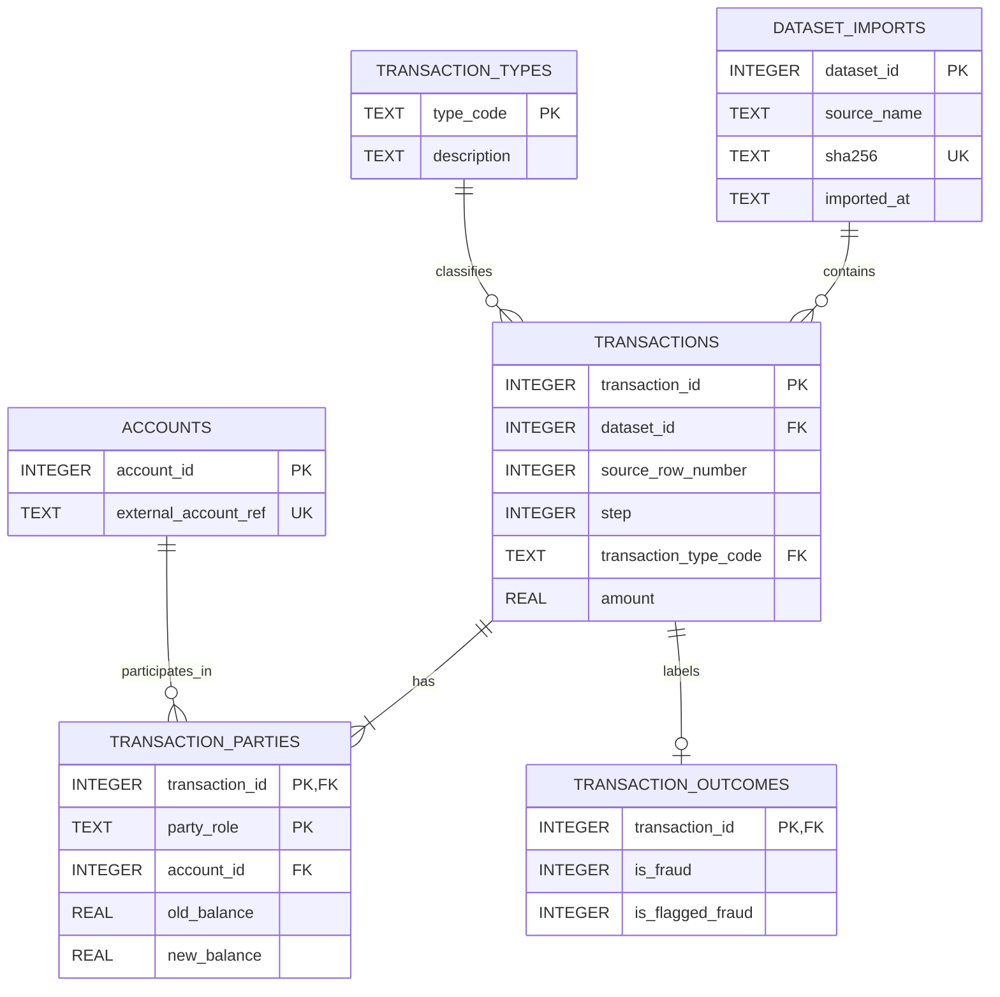

# PaySim Dataset Normalization and ERD

> **Status:** Proposed logical 3NF design for the PaySim-format training
> dataset. This is a data-model design, not a migration of the application's
> operational SQLite database.

## Scope

The project includes a local synthetic PaySim-format CSV at
`SYINTHETIC_FINANCIAL_DATASET/paysim.csv`. Its source columns are:

`step, type, amount, nameOrig, oldbalanceOrg, newbalanceOrig, nameDest, oldbalanceDest, newbalanceDest, isFraud, isFlaggedFraud`

Each data row represents one simulated transfer. PaySim has no transaction ID
in this CSV, so the relational design creates a surrogate `transaction_id` and
preserves each row's one-based data-record number within an identified dataset
import. The `step` field is the dataset's simulated time step, not a wall-clock
timestamp. Source values and labels are retained; this design does not infer
real customer identities or real-world account balances.

The application ERD in [SYSTEM_ANALYSIS_AND_DESIGN.md](./SYSTEM_ANALYSIS_AND_DESIGN.md)
describes the prototype's operational SQLite schema. This separate model
normalizes the training CSV and is not currently wired into that database:
the training pipeline reads the CSV directly.

## Normalization

The CSV is a flat, one-row-per-transaction relation. Its fields are scalar,
but it has no declared key and repeats account references, transaction type
codes, and account-level identifiers across rows.

1. **First Normal Form (1NF):** Keep one source transaction per row and
   preserve scalar values. Assign a key because the source has no transaction
   identifier.
2. **Second Normal Form (2NF):** Store each transaction once, and move its
   origin/destination party facts into rows keyed by transaction and party
   role. The party role distinguishes the two balance snapshots.
3. **Third Normal Form (3NF):** Store transaction-type descriptions and
   external account references once in their own relations. Keep fraud labels
   in a one-to-one transaction outcome relation. No non-key attribute in the
   proposed relations depends on another non-key attribute.

The intended functional dependencies are:

- `dataset_id -> source_name, sha256, imported_at`
- `transaction_type_code -> description`
- `account_id -> external_account_ref`
- `transaction_id -> dataset_id, source_row_number, step, transaction_type_code, amount`
- `(transaction_id, party_role) -> account_id, old_balance, new_balance`
- `transaction_id -> is_fraud, is_flagged_fraud`

The original balance columns remain transaction-party snapshots; they are not
stored as a current balance on `accounts`. `step` remains on `transactions`
because the CSV supplies no independent step attributes that would justify a
separate step relation.

## Field mapping

| Source column | Normalized destination |
|---|---|
| `step` | `transactions.step` |
| `type` | `transactions.transaction_type_code` → `transaction_types.type_code` |
| `amount` | `transactions.amount` |
| `nameOrig` | `transaction_parties.account_id` for role `ORIGIN` → `accounts.external_account_ref` |
| `oldbalanceOrg`, `newbalanceOrig` | `transaction_parties.old_balance`, `new_balance` for role `ORIGIN` |
| `nameDest` | `transaction_parties.account_id` for role `DESTINATION` → `accounts.external_account_ref` |
| `oldbalanceDest`, `newbalanceDest` | `transaction_parties.old_balance`, `new_balance` for role `DESTINATION` |
| `isFraud`, `isFlaggedFraud` | `transaction_outcomes.is_fraud`, `is_flagged_fraud` |
| CSV row position | `transactions.source_row_number`, unique within `dataset_id` |

## Entity-Relationship Diagram



`TRANSACTION_PARTIES` uses the composite key `(transaction_id, party_role)`;
each imported transaction must have exactly one `ORIGIN` and one
`DESTINATION` row. The role check prevents other roles. The importer must
validate the required pair because a row-level SQLite constraint cannot
require both related rows to exist.

## SQLite reference DDL

This DDL illustrates the proposed design. It is not applied to
`backend/fraud.db`; import and migration code would be a separate implementation
change.

```sql
PRAGMA foreign_keys = ON;

CREATE TABLE dataset_imports (
    dataset_id INTEGER PRIMARY KEY,
    source_name TEXT NOT NULL,
    sha256 TEXT NOT NULL UNIQUE,
    imported_at TEXT NOT NULL
);

CREATE TABLE transaction_types (
    type_code TEXT PRIMARY KEY,
    description TEXT NOT NULL
);

CREATE TABLE accounts (
    account_id INTEGER PRIMARY KEY,
    external_account_ref TEXT NOT NULL UNIQUE
);

CREATE TABLE transactions (
    transaction_id INTEGER PRIMARY KEY,
    dataset_id INTEGER NOT NULL REFERENCES dataset_imports(dataset_id),
    source_row_number INTEGER NOT NULL CHECK (source_row_number > 0),
    step INTEGER NOT NULL CHECK (step >= 0),
    transaction_type_code TEXT NOT NULL
        REFERENCES transaction_types(type_code),
    amount REAL NOT NULL CHECK (amount >= 0),
    UNIQUE (dataset_id, source_row_number)
);

CREATE TABLE transaction_parties (
    transaction_id INTEGER NOT NULL REFERENCES transactions(transaction_id),
    party_role TEXT NOT NULL CHECK (party_role IN ('ORIGIN', 'DESTINATION')),
    account_id INTEGER NOT NULL REFERENCES accounts(account_id),
    old_balance REAL NOT NULL,
    new_balance REAL NOT NULL,
    PRIMARY KEY (transaction_id, party_role)
);

CREATE TABLE transaction_outcomes (
    transaction_id INTEGER PRIMARY KEY
        REFERENCES transactions(transaction_id),
    is_fraud INTEGER NOT NULL CHECK (is_fraud IN (0, 1)),
    is_flagged_fraud INTEGER NOT NULL CHECK (is_flagged_fraud IN (0, 1))
);

CREATE INDEX idx_transactions_step ON transactions(step);
CREATE INDEX idx_transactions_type ON transactions(transaction_type_code);
CREATE INDEX idx_transaction_parties_account
    ON transaction_parties(account_id);
```

Seed `transaction_types` with the distinct `type` codes present in the input
(the standard PaySim codes are `CASH_IN`, `CASH_OUT`, `DEBIT`, `PAYMENT`, and
`TRANSFER`). The loader should upsert each distinct external account reference
once, create two party rows per source record, and create one outcome row per
source record. Keep the dataset hash and source record number so normalized
rows can be traced back to their input.

## Project boundary

This is a reference schema for analysis and reproducible training-data
ingestion. The existing prototype database remains the source of operational
transactions, risk assessments, alerts, cases, and audit records. Adopting
this model in the runtime requires a separately reviewed importer, migration,
and application query changes; this document alone does not imply those
changes have been made.
