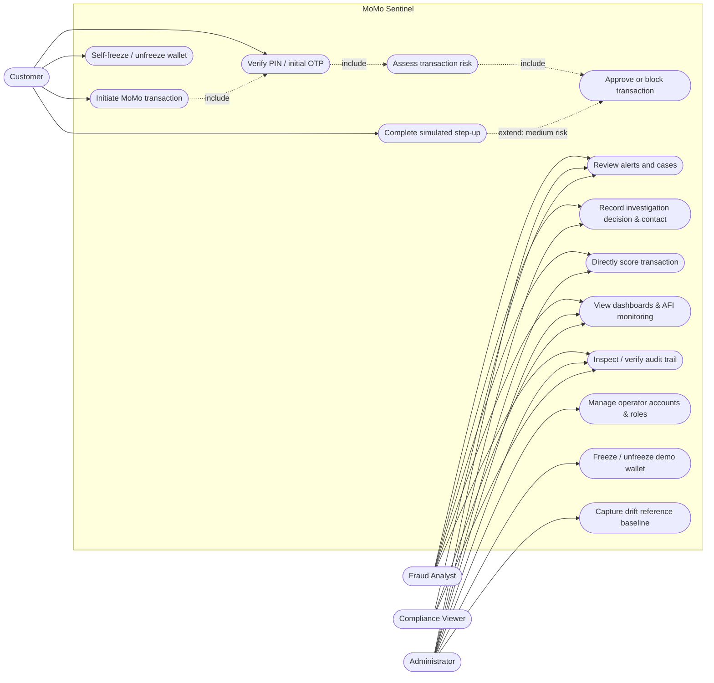
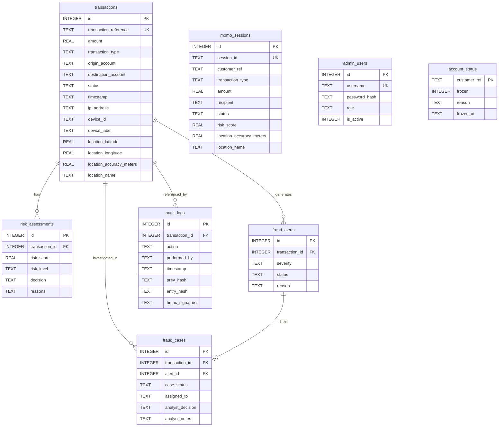
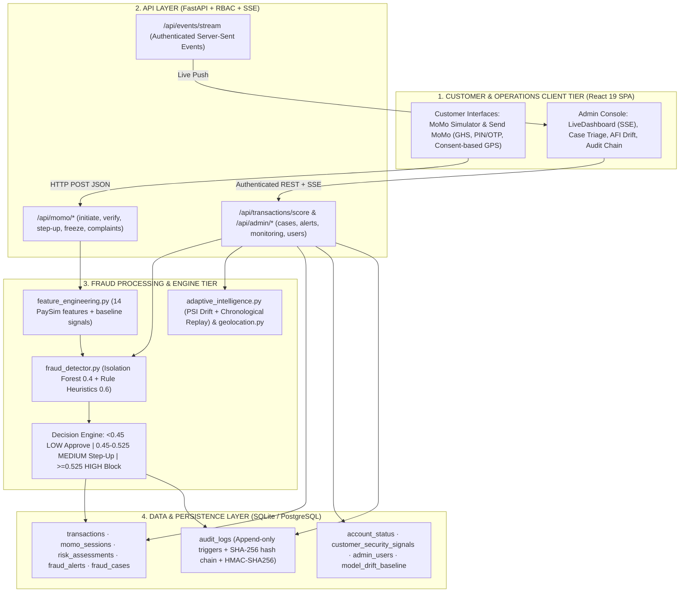
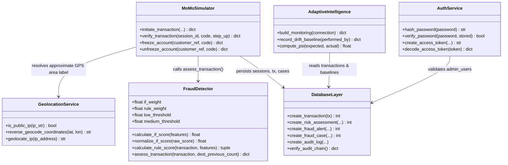
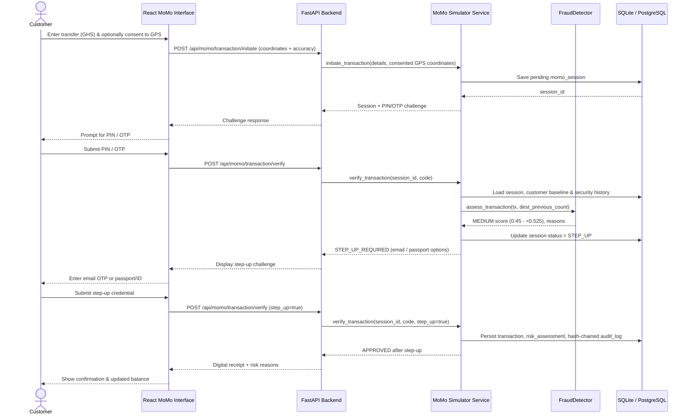

**UNITED STATES INTERNATIONAL UNIVERSITY — AFRICA**  
*School of Science and Technology*  
*Nairobi, Kenya*

---

# MOMO SENTINEL
### AI-Based Behavioral Fraud Detection & Risk Control
#### Post-Authentication Transaction Security for Mobile Money Services in Ghana

---

**A Final Project Report Submitted in Partial Fulfilment of the Requirements for the Course APT3065A**

**Submitted by:**  
**Hamdallah Alhassan** — Student ID: `671680`  
**Idhil Hassan** — Student ID: `671389`  
**Istar Abdille** — Student ID: `671007`

**Supervisor / Instructor:**  
**Prof. Patrick Wamuyu**

**Semester:** Fall 2026  
**Date:** 25th November, 2026

---

## DECLARATION

We, **Hamdallah Alhassan** (Student ID: `671680`), **Idhil Hassan** (Student ID: `671389`), and **Istar Abdille** (Student ID: `671007`), declare that this project report is our own original work and has not, to the best of our knowledge, been submitted for any other academic award in any institution of higher learning. All sources of information have been acknowledged by means of in-text citations and a comprehensive reference list.

| Student Name | Student ID | Signature | Date |
|---|---|---|---|
| Hamdallah Alhassan | 671680 | ___________________________ | _________________ |
| Idhil Hassan | 671389 | ___________________________ | _________________ |
| Istar Abdille | 671007 | ___________________________ | _________________ |

This project report has been submitted for examination with my approval as the appointed supervisor.

Signed: ____________________________________     Date: _____________________  
**Prof. Patrick Wamuyu** (Supervisor)

---

## ACKNOWLEDGEMENTS

We acknowledge the guidance, critique, and supervision provided by **Prof. Patrick Wamuyu** throughout the design, implementation, and evaluation of MoMo Sentinel. We further acknowledge the faculty of the School of Science and Technology at United States International University — Africa for the coursework preparation in systems analysis, software engineering, and cybersecurity that made this project possible.

We are grateful to E. A. Lopez-Rojas, A. Elmir, and S. Axelsson for the publication and maintenance of the PaySim synthetic mobile-money dataset, which provided the empirical benchmark for training and evaluating the anomaly-detection model in this prototype. We also acknowledge the Bank of Ghana's publicly accessible regulatory publications and FinTech reports, which grounded the Ghanaian mobile-money threat context and architectural control design.

Finally, we thank our peers for academic discussions and informal feedback shared during the project. No formal user-acceptance study is claimed in this report. All architectural choices, implementation work, empirical evaluations, and interpretations of results remain the responsibility of the project team.

---

## ABSTRACT

MoMo Sentinel implements a hybrid fraud-detection engine that combines an unsupervised **Isolation Forest** anomaly detector (trained on 14 engineered features from the PaySim synthetic financial dataset) with weighted **behavioural and security rule heuristics** (`0.4` Isolation Forest weight and `0.6` rule weight). The system evaluates per-customer historical baselines (transaction amounts, Africa/Accra active hours, daily frequency, short-window velocity, and recipient novelty) alongside simulated and browser-derived security signals (device changes, IP/network mismatches, consented GPS coordinates with device-reported accuracy, implausible travel speed, and simulated SIM-swap flags). Browser geolocation is an estimate, not a guarantee of the device’s physical position (World Wide Web Consortium, 2026); the Admin console therefore prioritizes coordinates and reported uncertainty over approximate reverse-geocoded labels. Based on the resulting hybrid risk score, transactions are routed into three risk tiers: **LOW** (`< 0.45`, auto-approved), **MEDIUM** (`0.45 – < 0.525`, requiring step-up verification via simulated email OTP or saved passport/ID), and **HIGH** (`>= 0.525`, automatically blocked with fraud alert creation, investigation case generation, and session protection). The prototype is delivered as a four-tier architecture comprising a **React 19** single-page interface (customer MoMo simulator, Ghana Cedi (`GHS`) MTN sandbox disbursement portal, live operations dashboard, Adaptive Fraud Intelligence console, and cryptographic audit viewer), a **FastAPI** backend with Server-Sent Events (SSE), and a **SQLite/PostgreSQL** persistence layer featuring append-only triggers and SHA-256 hash-chained, HMAC-signed audit logs. Reverse-geocoded place names are approximate labels, not verified street addresses, and IP-derived locations are not substituted for missing GPS.

Empirical evaluation on a chronological PaySim holdout split (59,850 test transactions containing 461 fraud labels, steps 355–742) demonstrates that the Isolation Forest baseline alone yields 6.91% precision, 35.36% recall, 3.70% false-positive rate, and 0.822 ROC-AUC, while the hybrid policy at the `0.45 / 0.525` boundaries improves performance to **17.3% precision and 71.4% recall** (2.7% false-positive rate) at MEDIUM-or-higher and **23.4% precision and 36.4% recall** (0.9% false-positive rate) at HIGH. On a temporally separated PaySim feature benchmark recorded in the active model configuration, the combined model achieves **90.68% ROC-AUC, 43.45% PR-AUC, 55.73% precision, 44.25% recall, and 49.33% F1-score**. Across 13 deterministic synthetic security scenarios (100 runs each), the engine achieved a **100% policy pass rate**, and an end-to-end ASGI scoring benchmark (100 runs) recorded a **32.09 ms mean latency** (p95: 37.82 ms). All **168 automated backend unit and integration tests** and the production frontend build pass.

The project makes three main contributions: (1) an integrated prototype demonstrating post-authentication behavioural risk control and tiered decisioning tailored to Ghanaian mobile-money workflows with `GHS` customer-facing labels; (2) a hybrid detection and Adaptive Fraud Intelligence architecture combining Isolation Forest, interpretable customer baselines, Population Stability Index (PSI) drift monitoring, and tamper-evident audit chaining; and (3) an empirical evaluation quantifying precision–recall trade-offs, sub-40 ms scoring latency, and the practical boundaries of synthetic-data fraud prototypes.

---

## TABLE OF CONTENTS

- [DECLARATION](#declaration)
- [ACKNOWLEDGEMENTS](#acknowledgements)
- [ABSTRACT](#abstract)
- [CHAPTER 1: INTRODUCTION](#chapter-1-introduction)
  - [1.1 Background of the Study](#11-background-of-the-study)
  - [1.2 Problem Statement](#12-problem-statement)
  - [1.3 Project Objectives](#13-project-objectives)
  - [1.4 Research Questions](#14-research-questions)
  - [1.5 Scope and Delimitations](#15-scope-and-delimitations)
    - [1.5.1 Scope Fulfilment Review](#151-scope-fulfilment-review)
  - [1.6 Significance of the Study](#16-significance-of-the-study)
  - [1.7 Structure of the Report](#17-structure-of-the-report)
- [CHAPTER 2: LITERATURE REVIEW](#chapter-2-literature-review)
  - [2.1 Introduction](#21-introduction)
  - [2.2 Mobile Money in Ghana and Its Fraud Landscape](#22-mobile-money-in-ghana-and-its-fraud-landscape)
  - [2.3 Regulatory Frameworks and Security Guidelines](#23-regulatory-frameworks-and-security-guidelines)
  - [2.4 Existing Fraud Detection Systems and Their Limitations](#24-existing-fraud-detection-systems-and-their-limitations)
  - [2.5 Prior Research Using the PaySim Dataset](#25-prior-research-using-the-paysim-dataset)
  - [2.6 Unsupervised Anomaly Detection, Hybrid Scoring, and Concept Drift](#26-unsupervised-anomaly-detection-hybrid-scoring-and-concept-drift)
  - [2.7 Synthesis and the Gap Addressed](#27-synthesis-and-the-gap-addressed)
- [CHAPTER 3: SYSTEM ANALYSIS](#chapter-3-system-analysis)
  - [3.1 Methodology of Analysis](#31-methodology-of-analysis)
  - [3.2 Stakeholder Analysis](#32-stakeholder-analysis)
  - [3.3 Requirements Analysis](#33-requirements-analysis)
  - [3.4 Use Case Model](#34-use-case-model)
  - [3.5 Data Model and Normalisation to Third Normal Form](#35-data-model-and-normalisation-to-third-normal-form)
  - [3.6 Constraints and Assumptions](#36-constraints-and-assumptions)
- [CHAPTER 4: SYSTEM DESIGN](#chapter-4-system-design)
  - [4.1 Architectural Pattern Selection and Justification](#41-architectural-pattern-selection-and-justification)
  - [4.2 Service-Style Decomposition of the Backend Layer](#42-service-style-decomposition-of-the-backend-layer)
  - [4.3 Class and Component Design](#43-class-and-component-design)
  - [4.4 Sequence Design for the Primary Workflow](#44-sequence-design-for-the-primary-workflow)
  - [4.5 Hybrid Detection Engine and Risk-Scoring Algorithms](#45-hybrid-detection-engine-and-risk-scoring-algorithms)
  - [4.6 Adaptive Fraud Intelligence and Cryptographic Audit Design](#46-adaptive-fraud-intelligence-and-cryptographic-audit-design)
  - [4.7 User Interface Design](#47-user-interface-design)
- [CHAPTER 5: IMPLEMENTATION, TESTING, AND EVALUATION](#chapter-5-implementation-testing-and-evaluation)
  - [5.1 Introduction](#51-introduction)
  - [5.2 Technology Stack](#52-technology-stack)
  - [5.3 Build Sequence and Methodology in Practice](#53-build-sequence-and-methodology-in-practice)
  - [5.4 Testing Strategy and Execution](#54-testing-strategy-and-execution)
  - [5.5 Defect Log and Engineering Lessons Learned](#55-defect-log-and-engineering-lessons-learned)
  - [5.6 Quantitative Evaluation](#56-quantitative-evaluation)
    - [5.6.1 Isolation Forest and Hybrid Policy Evaluation on PaySim](#561-isolation-forest-and-hybrid-policy-evaluation-on-paysim)
    - [5.6.2 Synthetic Scenario Policy Verification and API Latency Benchmark](#562-synthetic-scenario-policy-verification-and-api-latency-benchmark)
  - [5.7 Deployed System Walkthrough and Interface Overview](#57-deployed-system-walkthrough-and-interface-overview)
- [CHAPTER 6: DISCUSSION, CONCLUSION, AND RECOMMENDATIONS](#chapter-6-discussion-conclusion-and-recommendations)
  - [6.1 Introduction](#61-introduction)
  - [6.2 Answering the Research Questions](#62-answering-the-research-questions)
  - [6.3 Contributions to Knowledge and Practice](#63-contributions-to-knowledge-and-practice)
  - [6.4 Limitations](#64-limitations)
  - [6.5 Recommendations for Future Work](#65-recommendations-for-future-work)
- [REFERENCES](#references)

---

## CHAPTER 1: INTRODUCTION

### 1.1 Background of the Study

Mobile money has become a foundational pillar of Ghana's financial system, transforming how individuals, merchants, and enterprises store value, transfer funds, and access financial services without maintaining traditional bank accounts. Services such as MTN Mobile Money (MoMo), Telecel Cash, and AT Money underpin daily commerce and financial inclusion across urban and rural communities. According to the Bank of Ghana (2026), Ghana recorded approximately 80.5 million registered mobile money accounts, 26.6 million active accounts, and 9.70 billion transactions valued at GH¢4.54 trillion in 2025. These figures underscore the systemic importance of mobile money within the Ghanaian economy.

The rapid expansion of mobile money has simultaneously introduced complex security and operational risks. Mobile money ecosystems process high-velocity transactions across interconnected networks comprising customers, agents, banks, and Payment Service Providers (PSPs). This environment creates lucrative attack surfaces for impersonation, identity theft, social engineering, unauthorized account takeover, and SIM-swap fraud. The Bank of Ghana's 2024 Fraud Report recorded 16,733 fraud cases across banks, Specialised Deposit-Taking Institutions (SDIs), and PSPs—a 5 percent increase from the 15,865 cases reported in 2023—highlighting impersonation and identity theft among the fastest-growing categories (Bank of Ghana, 2025).

In response to these evolving threats, financial regulators have emphasized automated transaction monitoring and adaptive security controls. The Bank of Ghana's *Cyber and Information Security Directive* (2019) mandates that regulated institutions deploy automated mechanisms to monitor and detect anomalous activity in customer accounts, particularly when high-risk transactions are underway, and continually update monitoring controls to counter emerging fraud techniques. Alongside regulatory expectations, advances in machine learning—particularly unsupervised anomaly detection algorithms such as Isolation Forest (Liu, Ting, & Zhou, 2008)—and open benchmark datasets such as PaySim (Lopez-Rojas, Elmir, & Axelsson, 2016) provide practical foundations for studying automated behavioural risk scoring.

Building on these developments, this project presents **MoMo Sentinel**, an AI-based behavioural fraud detection and transaction risk-control prototype designed for Ghana's mobile money environment. The system operates as a post-authentication security layer: after a customer supplies a PIN or OTP, MoMo Sentinel evaluates transaction features against historical customer baselines and security signals, combines an Isolation Forest anomaly score with heuristic rules, routes transactions into actionable risk tiers (`LOW`, `MEDIUM`, `HIGH`), and monitors distribution drift through an Adaptive Fraud Intelligence (AFI) console.

### 1.2 Problem Statement

A fundamental limitation in conventional mobile money security is that successful credential authentication does not guarantee the legitimacy of the person initiating the transaction. Mechanisms such as 4-digit PINs and SMS One-Time Passwords (OTPs) verify only that valid credentials were entered. When attackers compromise a victim's credentials through phishing, social engineering, device theft, or SIM-swap attacks, they can pass initial authentication checks and execute unauthorized transfers—including Wallet-to-Wallet (`TRANSFER`), Wallet-to-Bank (`CASH_OUT`), and Bank-to-Wallet (`CASH_IN`) movements—before the victim notices. The Bank of Ghana has repeatedly identified impersonation, social engineering, and unauthorized account access as major threats across the financial sector (Bank of Ghana, 2025, 2026).

Conventional transaction monitoring systems that rely exclusively on static rules and fixed monetary thresholds fail to capture subtle deviations in individual customer behaviour. A fraudulent transfer may fall below a daily transfer cap and pass PIN authentication while exhibiting clear anomalies relative to the account holder's normal behaviour—such as an unfamiliar recipient, an unusual hour of activity in `Africa/Accra` time, a sharp deviation from median transaction amounts, a sudden transaction velocity burst, an unrecognized device, an IP/network change, or an implausible geographic jump.

Conversely, deploying a standalone machine learning model without decision enforcement or operational tooling does not constitute a complete fraud-control layer. An effective system must translate risk scores into proportionate real-time transaction actions (approving routine activity, stepping up ambiguous transactions, and holding or blocking high-risk attempts), provide Fraud Analysts and Administrators with case-triage workflows and tamper-evident audit trails, and monitor for concept drift so that detection performance does not silently degrade over time. The central problem addressed by this project is therefore the absence of an accessible, integrated, post-authentication behavioural fraud detection and risk-control prototype tailored to Ghanaian mobile money workflows.

### 1.3 Project Objectives

**General Objective:**  
To design, implement, and evaluate a prototype AI-based behavioural fraud detection and transaction risk-control system for identifying and mitigating abnormal post-authentication mobile-money transactions in Ghana.

**Specific Objectives:**
1. To examine mobile-money fraud patterns, Ghanaian regulatory expectations (Bank of Ghana, 2019, 2025, 2026), and key post-authentication behavioural and security risk indicators relevant to Wallet-to-Wallet, Wallet-to-Bank, and Bank-to-Wallet ecosystems.
2. To develop a hybrid behavioural risk-scoring model combining an unsupervised Isolation Forest trained on PaySim synthetic data (Lopez-Rojas et al., 2016) with domain-informed heuristic rules, alongside an Adaptive Fraud Intelligence (AFI) module for Population Stability Index (PSI) drift monitoring.
3. To implement a secure Python-based FastAPI backend, SQLite/PostgreSQL persistence layer with cryptographic audit chaining, and React 19 administrative and simulator interfaces operating in Ghana Cedis (`GHS`) with accurate customer device and location telemetry, and to evaluate the prototype using holdout classification metrics, deterministic policy checks, and API decision latency benchmarks.

### 1.4 Research Questions

The following research questions guided the design, implementation, and evaluation of MoMo Sentinel:

- **RQ1:** Can a hybrid fraud detection approach combining an unsupervised Isolation Forest model and rule-based heuristics effectively identify suspicious mobile-money transactions on the PaySim synthetic dataset compared with relying on the model alone?
- **RQ2:** To what extent can explicit behavioural, network, device, and location indicators complement PaySim-trained anomaly scores to detect post-authentication compromise scenarios (such as SIM swaps, device changes, and impossible travel)?
- **RQ3:** Can a three-tier transaction risk assessment mechanism (`LOW`, `MEDIUM`, `HIGH`) translate hybrid risk scores into proportionate operational actions—automatic approval, step-up identity verification, and blocking with case generation?
- **RQ4:** Can the proposed prototype integrate scoring, real-time Server-Sent Events (SSE) monitoring, role-based case management, and hash-chained audit logging while maintaining acceptable sub-second transaction scoring latency?
- **RQ5:** To what extent can an Adaptive Fraud Intelligence component using PSI drift tracking and chronological window replay monitor changes in transaction distributions and surface potential model degradation over time?

### 1.5 Scope and Delimitations

MoMo Sentinel delivers a full-stack web prototype simulating an integrated post-authentication fraud detection and risk-control layer for Ghanaian mobile-money transactions (`TRANSFER` / Wallet-to-Wallet, `CASH_OUT` / Wallet-to-Bank, and `CASH_IN` / Bank-to-Wallet) denominated in Ghana Cedis (`GHS`). The core system includes:
- A customer mobile-money simulator (`MoMoSimulator`) and a sandbox MTN MoMo disbursement client (`MTNDisbursement`) capturing device labels, client IPs, and explicitly consented, freshly requested browser GPS coordinates with the device-reported accuracy radius. Reverse-geocoded names are approximate area labels; the stored coordinate is the primary location value.
- A hybrid scoring engine (`FraudDetector`) combining a `scikit-learn` Isolation Forest trained on PaySim (`backend/models/paysim-runtime/`) with weighted heuristic rules.
- A three-tier automated decision engine (`LOW` approve, `MEDIUM` step-up via simulated email OTP or passport/ID, `HIGH` block + fraud alert + investigation case + session protection).
- A role-based administrative operations console (`admin`, `analyst`, `viewer`) featuring live KPI monitoring over SSE, fraud case triage, simulated customer contact, wallet freeze/unfreeze controls, Adaptive Fraud Intelligence (PSI drift and PaySim replay), and SHA-256 hash-chained, HMAC-signed append-only audit logs.

**Hard Boundaries and Constraints:**
- **Time:** 14-week academic student project completed across structured Agile sprints.
- **Budget:** Maximum budget of KSh 5,000 (KSh 3,000 allocated for cloud/sandbox testing infrastructure and KSh 2,000 contingency), favouring zero-cost local execution and free-tier sandbox services.
- **Data:** Exclusively synthetic transaction data from PaySim (Lopez-Rojas et al., 2016) and artificially generated or locally simulated network, device, and SIM-swap signals; zero live customer financial records were collected or processed.
- **Integration:** Mock/simulated FastAPI endpoints for customer wallets, email/SMS OTP hints, and voice call rings, plus strictly gated sandbox clients for MTN Collection and Disbursement APIs rather than live production telecom/bank switching.
- **Infrastructure:** Local workstation development (FastAPI + Uvicorn + SQLite) and basic cloud sandbox configuration (`render.yaml` / `vercel.json`) without multi-node high-availability deployment.
- **Testing:** Automated unit/integration testing (`unittest` + `TestClient`) and synthetic policy suites using fictional accounts and demo scenarios. No formal human acceptance study is claimed.

The scope assessment below distinguishes a completed prototype feature from a production capability. “Met” means implemented and verified within the stated synthetic/sandbox boundary; it does not imply a live financial-service deployment.

### 1.5.1 Scope Fulfilment Review

| Planned scope / requirement | Evidence in the delivered prototype | Status and boundary |
|---|---|---|
| Examine Ghana mobile-money threats, regulatory context, and behavioural risk indicators | Literature review; PaySim and Bank of Ghana sources; indicators documented in the scoring design | **Met for the academic prototype.** Legal compliance is not certified. |
| Hybrid Isolation Forest and rule-based risk scoring | PaySim-trained Isolation Forest, 14 engineered features, weighted rules, and chronological evaluation | **Met.** Performance results are specific to PaySim and the recorded evaluation split. |
| Adaptive Fraud Intelligence and drift monitoring | PSI dashboards, baseline capture, chronological PaySim replay and threshold analysis | **Partially met.** Monitoring and offline replay are implemented; automatic retraining and live labelled-outcome feedback are not. |
| LOW / MEDIUM / HIGH routing with approve, step-up, and block actions | Customer transaction flows, simulated step-up, high-risk alerts and case creation | **Met in simulation.** No production payment switch is controlled by this prototype. |
| Operations dashboard, role controls, case management, and auditability | RBAC-protected React console, SSE updates, case/alert review, account controls, and append-only hash/HMAC audit records | **Met in prototype.** Formal compliance certification and independent penetration testing were not performed. |
| Ghana Cedi presentation | Customer-facing React transaction amounts, balances, receipts, and error messages use `GHS` | **Met at the interface.** The MTN disbursement sandbox adapter retains its configured wire-level `EUR` currency; no exchange-rate conversion or live GHS provider transaction is implemented. |
| Customer location displayed in Admin | Fresh, consented browser GPS coordinates and reported accuracy are stored with transaction/session records; Admin links the coordinates to OpenStreetMap | **Met with device limitations.** Place-name reverse geocoding is approximate; GPS can be unavailable, inaccurate, or spoofed. Missing GPS is shown as unavailable rather than replaced with an IP guess or fabricated location. |
| Use real Ghanaian customer records and connect directly to production telecom/bank systems | Not used; PaySim, fictional/demo wallets, and gated sandbox adapters are used | **Not in scope / not met.** The concept paper explicitly limits data to synthetic records and integrations to simulated or sandbox services; real data access and operator authorization were unavailable. |
| Production availability, independently validated HTTPS deployment, and multi-node operation | Local SQLite/ASGI execution and basic deployment configuration; no production readiness evidence | **Not demonstrated.** The project boundary excludes high availability and production deployment; TLS depends on deployment hosting and was not independently verified here. |
| Human convenience-user acceptance study | Automated tests and deterministic demo scenarios are documented; no reproducible participant protocol or results are present | **Not demonstrated.** No defensible human-study sample, consent record, or measured usability findings were available for this report. |

Accordingly, the approved **prototype** scope is substantially implemented, with the AFI closed-loop, location accuracy, and human evaluation boundaries stated above. It would be inaccurate to claim that all production or real-world requirements are met. The location display reports the browser/device’s measured point and stated uncertainty; software cannot guarantee a person’s physically exact position from browser GPS alone.

### 1.6 Significance of the Study

This project contributes both practically and methodologically to financial cybersecurity education and prototype engineering in West and East African mobile-money contexts. Practically, it demonstrates how an end-to-end post-authentication risk engine can sit *behind* existing PIN/OTP flows—addressing the operational gap where stolen credentials can bypass perimeter authentication. Unlike notebook-only experiments, MoMo Sentinel couples risk scoring with customer UX (step-up verification, self-service emergency freeze, dispute complaints) and analyst governance (RBAC, case resolution, coordinate-based location review, and cryptographic audit trails).

Methodologically, the project documents honest empirical boundaries: it separates synthetic PaySim holdout metrics from deterministic policy checks, demonstrates how combining rules with Isolation Forest raises recall and precision over standalone anomaly detection on imbalanced transaction streams, and illustrates why continuous PSI monitoring and human-in-the-loop analyst review are essential when deploying unsupervised detectors in dynamic payment ecosystems.

### 1.7 Structure of the Report

The remainder of this report is organized as follows. **Chapter 2** reviews literature on Ghanaian mobile-money fraud, Bank of Ghana regulatory expectations, existing detection systems, PaySim research, and imbalanced anomaly detection. **Chapter 3** presents the system analysis, Agile methodology, stakeholders, requirements, use-case model, and 3NF data normalization. **Chapter 4** details the four-tier architecture, backend services, class and sequence diagrams, hybrid scoring formulas, audit chaining, and UI design. **Chapter 5** documents implementation, the 168-test verification suite, resolved engineering defects, and quantitative evaluation results. **Chapter 6** answers the research questions, summarizes contributions and limitations, and outlines future work.

---

## CHAPTER 2: LITERATURE REVIEW

### 2.1 Introduction

This chapter synthesizes research and primary-source material underpinning MoMo Sentinel: (1) Ghanaian mobile-money activity and reported fraud; (2) Bank of Ghana payment-security instruments; (3) research on transaction fraud and anomaly detection; and (4) the PaySim dataset, class-imbalance evaluation, concept drift, and the limitations of browser geolocation.

### 2.2 Mobile Money in Ghana and Its Fraud Landscape

Mobile money enables users to store electronic value and transact using mobile handsets without requiring conventional bank branches. In Ghana, interoperability across mobile-money services and bank-to-wallet (`B2W`) and wallet-to-bank (`W2B`) rails has made mobile money a major part of retail payments. The Bank of Ghana reported 26.6 million active accounts and GH¢4.54 trillion in mobile-money transaction value in 2025 (Bank of Ghana, 2026, p. 12).

However, real-time settlement and high transaction velocity create acute fraud exposure. Common attack patterns documented in African mobile-money ecosystems include:
- **Social Engineering and Impersonation:** Attackers pose as telecom support agents or relatives to trick customers into disclosing their PINs, approving fraudulent prompts, or forwarding OTPs (Bank of Ghana, 2025).
- **SIM-Swap and Credential Abuse:** A SIM-swap can redirect SMS-based verification to a replacement SIM; this report treats the resulting account-takeover path as a threat scenario, not as a measured rate in the PaySim data. The Bank of Ghana's fraud reporting provides the Ghanaian institutional context for impersonation and social-engineering risks (Bank of Ghana, 2025).
- **Wallet Takeover and Rapid Drain:** PaySim includes simulated fraudulent transfers and cash-outs, which provide a controlled benchmark for studying such transaction patterns; they do not establish the prevalence or exact operation of these attacks in Ghanaian production networks (Lopez-Rojas et al., 2016).

Because PINs and OTPs validate *possession of credentials* rather than *behavioural authenticity*, post-authentication behavioural monitoring is increasingly critical to intercept unauthorized transfers before settlement is irreversible.

### 2.3 Regulatory Frameworks and Security Guidelines

In Ghana, payment service providers and mobile-money operators operate under statutory oversight from the Bank of Ghana. Three regulatory instruments provide important architectural context for fraud-monitoring prototypes:
1. **Payment Systems and Services Act, 2019 (Act 987):** Establishes the licensing, governance, consumer-protection, and risk-management framework for electronic money issuers and payment service providers in Ghana (Bank of Ghana, 2019a).
2. **Cyber and Information Security Directive (2019):** Provides the security-control and monitoring context for regulated financial institutions (Bank of Ghana, 2019b). MoMo Sentinel uses the directive as design context; this report is not a legal compliance assessment.
3. **Anti-Money Laundering / Combating the Financing of Terrorism (AML/CFT) Guidelines (2022):** Emphasizes risk-based transaction monitoring, suspicious activity escalation, customer due diligence (KYC), and auditable record-keeping (Bank of Ghana, 2022).

As documented in `ARCHITECTURE.md`, MoMo Sentinel aligns its *design themes*—risk-based transaction tiering, analyst escalation workflows, RBAC, and hash-chained audit logs—with these regulatory principles, while explicitly noting that formal clause-by-clause legal compliance verification lies outside an academic prototype's scope.

### 2.4 Existing Fraud Detection Systems and Their Limitations

Research on financial fraud detection has examined statistical classification and data-mining methods, including credit-card fraud, while process-behaviour analysis has also been studied for mobile payments (Ngai et al., 2011; Bhattacharyya et al., 2011; Rieke et al., 2013). These works establish relevant approaches but do not evaluate MoMo Sentinel or prove the effectiveness of any commercial product. Fixed thresholds are transparent but do not, on their own, adapt to each customer's historical pattern. Offline model evaluation also does not provide operational controls such as customer step-up, case triage, audit verification, or drift monitoring. MoMo Sentinel implements these as an integrated prototype; no head-to-head comparison with a commercial platform was conducted.

MoMo Sentinel bridges this gap by integrating an open, reproducible ML + heuristic engine with a complete interactive customer simulator, step-up controls, analyst case console, and drift-monitoring dashboard.

### 2.5 Prior Research Using the PaySim Dataset

Because real mobile-money transaction logs are protected by strict financial privacy and data-protection statutes, Lopez-Rojas et al. (2016) introduced **PaySim**, a multi-agent financial simulator calibrated against aggregated statistics from an African mobile-money operator. The full PaySim dataset contains 6,362,620 transactions across 744 hourly steps across five transaction types (`CASH_IN`, `CASH_OUT`, `DEBIT`, `PAYMENT`, `TRANSFER`), with ground-truth fraud occurring exclusively in `TRANSFER` and `CASH_OUT` transactions (8,213 fraud rows, or ~0.13% prevalence).

PaySim is highly class-imbalanced: a classifier that predicts every row as non-fraud would achieve approximately 99.87% accuracy while detecting no fraud. For this reason, this project reports precision, recall, F1, PR-AUC and ROC-AUC rather than relying on accuracy alone; precision-recall curves are particularly informative for imbalanced classification (Saito & Rehmsmeier, 2015). The evaluation partitions the selected PaySim rows chronologically by `step`, so later time steps are held out from training and validation.

### 2.6 Unsupervised Anomaly Detection, Hybrid Scoring, and Concept Drift

In emerging payment environments where labelled fraud cases are scarce, delayed, or skewed toward previously discovered attacks, unsupervised anomaly detection provides a complement to rule-based controls (Chandola, Banerjee, & Kumar, 2009). **Isolation Forest** (Liu et al., 2008) isolates anomalies through random feature-space partitions; anomalous observations tend to have shorter average path lengths. Its use of subsampling supports efficient anomaly scoring, and this implementation fits the model on normal training rows using the project's PaySim feature pipeline and robust scaling (Pedregosa et al., 2011).

However, unsupervised models alone can flag benign outliers, and PaySim contains no telecom, device, IP, or GPS telemetry. Combining an Isolation Forest score with explicit domain heuristics allows the detector to use both transaction anomalies and simulated security events. Payment behaviour also evolves over time (**concept drift**); PSI is used here to monitor amount and risk-score distributions against a reference baseline. The `0.10` and `0.25` warning/critical cutoffs are project-configured heuristics, not universal regulatory or statistical standards.

Browser geolocation also has an important evidence boundary: the web API supplies coordinates and an estimated accuracy value, but cannot guarantee the device's true physical position. The high-accuracy option is a request to the device/browser, not a guarantee of GPS-quality results. For this reason, the prototype requests location only with user consent, retains the reported accuracy in metres, presents mapped place names as approximate, and shows location as unavailable rather than inferring it when coordinates are missing (World Wide Web Consortium, 2026).

### 2.7 Synthesis and the Gap Addressed

The literature converges on three requirements for an effective mobile-money fraud-control prototype: (1) post-authentication behavioural analysis beyond static PIN/OTP checks; (2) hybrid anomaly + heuristic scoring evaluated honestly with precision-recall metrics on chronological splits; and (3) operational integration encompassing tiered step-up actions, analyst investigation workflows, cryptographic auditability, and drift monitoring. MoMo Sentinel addresses the integration gap between standalone ML scripts and practical Ghanaian mobile-money transaction control.

---

## CHAPTER 3: SYSTEM ANALYSIS

### 3.1 Methodology of Analysis

The project adopted an **Agile (Scrum)** iterative development methodology combined with structured system analysis. Development was organized into nine incremental sprints, enabling early validation of the PaySim model before wiring it into FastAPI services, React interfaces, and end-to-end simulation testing. Table 1 summarizes the sprint progression.

**Table 1.** *Agile (Scrum) Sprint Progression and Deliverables.*

| Sprint | Focus Area | Main Outcome |
|---|---|---|
| Sprint 1 | Sprint Planning | Project scope, backlog, and risk register |
| Sprint 2 | System Design & Architecture | Use-case, activity, sequence, class, and 3NF ERD specifications |
| Sprint 3 | Model Training & Evaluation | Chronological PaySim pipeline, `RobustScaler`, and Isolation Forest artifacts |
| Sprint 4 | Backend Development | FastAPI endpoints, SQLite/PostgreSQL persistence, and RBAC auth |
| Sprint 5 | Frontend Development | React 19 + Vite SPA (Simulator, Send MoMo, Admin Console) |
| Sprint 6 | Model Integration & Testing | `FraudDetector` service wired to `/api/momo/*` and `/api/transactions/score` |
| Sprint 7 | Adaptive Intelligence | PSI drift monitoring, baseline capture, and 4-window PaySim replay |
| Sprint 8 | Simulation Testing & Integration | 13 deterministic scenario checks, ASGI latency benchmark, and MTN sandbox client |
| Sprint 9 | System Testing & Refinement | Automated backend tests, `GHS` UI localization, and consented GPS capture with device-reported accuracy |

### 3.2 Stakeholder Analysis

MoMo Sentinel defines four operational user roles plus one adversarial threat-model actor:

**Table 2.** *System Actors and Responsibilities.*

| Actor | Responsibilities |
|---|---|
| **Customer** | Initiates simulated transfers (`TRANSFER`, `CASH_OUT`, `CASH_IN`), completes PIN/OTP authentication, responds to step-up challenges (email OTP or passport/ID), may share device GPS and its reported accuracy, submits block disputes/complaints, and self-freezes/unfreezes their demo wallet using a PIN. |
| **Fraud Analyst** | Reviews fraud alerts and open investigation cases, inspects GPS coordinates, reported accuracy, IP/device telemetry, records simulated customer contact outcomes (`CALL`/`SMS`), updates investigation decisions (`LEGITIMATE` / `FRAUD_CONFIRMED`), and submits direct transactions to `/api/transactions/score`. |
| **Administrator** | Performs all analyst actions plus manages operator accounts and roles, freezes/unfreezes demo wallets directly, captures PSI drift reference baselines, and resolves customer unfreeze requests. |
| **Compliance Viewer** | Holds read-only access to dashboards, alerts, cases, accounts, Adaptive Intelligence monitoring, and audit logs; verifies cryptographic SHA-256 hash-chain integrity. |
| **Attacker (Misuse Actor)** | Threat-model actor representing unauthorized parties attempting account takeover after credential compromise, SIM-swap exploitation, or unauthorized console access. |

### 3.3 Requirements Analysis

**Functional Requirements:**
1. **Transaction Initiation & Initial Auth:** Support `TRANSFER` (PIN-authenticated) and `CASH_OUT` / `CASH_IN` (OTP-authenticated) sessions with input validation and wallet-freeze enforcement.
2. **Post-Authentication Behavioural Scoring:** Extract 14 PaySim-compatible features alongside customer baseline profiles (median/MAD amount, `Africa/Accra` active hours, daily frequency, 5-minute and 1-hour velocity, recipient novelty) and security telemetry (device ID/label, client IP, consented GPS coordinates plus reported accuracy, approximate reverse-geocoded area, impossible travel, simulated SIM-swap flag).
3. **Three-Tier Risk Control:** Auto-approve `LOW` (`< 0.45`); trigger simulated email OTP or saved passport/ID step-up for `MEDIUM` (`0.45 – < 0.525`, failing closed if no factor is available); block `HIGH` (`>= 0.525`), emit a fraud alert, open an investigation case, and protect the session.
4. **Operations Console & Live Telemetry:** Provide SSE-driven live KPIs, charts, fraud alerts, investigation case review, simulated customer calling/SMS, customer complaint inbox, and wallet freeze/unfreeze controls.
5. **Adaptive Intelligence & Cryptographic Audit:** Compute transaction-level PSI drift for amount and risk score against a captured baseline, verify append-only SHA-256 hash-chained and HMAC-SHA256-signed audit logs, and enforce RBAC across routes.

**Non-Functional and Security Requirements:**
1. **Scoring Latency:** Achieve sub-100 ms mean in-process API scoring latency to support interactive transaction flows.
2. **Password & Token Security:** Hash operator and sandbox customer credentials with salted PBKDF2-HMAC-SHA256 (100,000 iterations), enforce 15-minute lockout after 5 failed admin login attempts, and sign bearer tokens with HMAC-SHA256.
3. **Tamper Evidence:** Enforce SQLite triggers blocking `UPDATE`/`DELETE` on `audit_logs` and verify chain continuity via `/api/admin/audit-logs/verify`.
4. **Honest Location & Currency Fidelity:** Present customer-facing amounts and balances in Ghana Cedis (`GHS`); display consented GPS coordinates and the device-reported accuracy, treating reverse-geocoded names as approximate and never substituting an IP guess or placeholder for missing GPS.

### 3.4 Use Case Model

Figure 1 illustrates the system boundary, actors, and primary use cases of MoMo Sentinel.

*Figure 1.* Use-case diagram of the MoMo Sentinel system.

### 3.5 Data Model and Normalisation to Third Normal Form

The data architecture of MoMo Sentinel addresses two complementary schemas documented in `DATA_NORMALIZATION_AND_ERD.md` and `SYSTEM_ANALYSIS_AND_DESIGN.md`:

1. **PaySim Training Dataset Normalisation (1NF → 2NF → 3NF):**  
   The raw PaySim CSV (`step, type, amount, nameOrig, oldbalanceOrg, newbalanceOrig, nameDest, oldbalanceDest, newbalanceDest, isFraud, isFlaggedFraud`) is an unnormalized flat relation lacking a transaction primary key and repeating account identifiers and type codes across 6.36 million rows.
   - **First Normal Form (1NF):** Preserve one atomic transaction per row and assign a surrogate `transaction_id` primary key alongside `(dataset_id, source_row_number)`.
   - **Second Normal Form (2NF):** Move origin and destination balance snapshots into `TRANSACTION_PARTIES` keyed by `(transaction_id, party_role)` where `party_role IN ('ORIGIN', 'DESTINATION')`, eliminating partial dependencies.
   - **Third Normal Form (3NF):** Separate transaction-type descriptions (`TRANSACTION_TYPES`), external account references (`ACCOUNTS`), import provenance (`DATASET_IMPORTS`), and ground-truth labels (`TRANSACTION_OUTCOMES`) so no non-key attribute depends transitively on another non-key attribute.

2. **Operational Persistence Schema (`fraud.db` / PostgreSQL):**  
   The operational database (`backend/database/database.py`) normalizes live sessions, scored transactions, assessments, alerts, investigation cases, customer security signals, complaints, RBAC users, drift baselines, and hash-chained audit logs into dedicated tables linked by foreign keys. Figure 2 presents the operational Entity-Relationship Diagram.

*Figure 2.* Operational Entity-Relationship Diagram (ERD) of the MoMo Sentinel database.

### 3.6 Constraints and Assumptions

Four core constraints governed the analysis and design:
1. **Synthetic Dataset Calibration:** PaySim reflects synthetic simulation dynamics calibration rather than live Ghanaian MTN MoMo distributions; therefore, monetary thresholds and Isolation Forest contamination boundaries are research controls requiring re-calibration on authorized operator data before production deployment.
2. **Simulated Telecom/Channel Signals:** SIM-swap indicators (`RECENT_SIM_SWAP`) and device-change scenario overrides simulate carrier telemetry without querying live mobile network operator HLRs.
3. **Privacy and Consent for Geolocation:** Device GPS coordinates require explicit consent (`location_consent = true`) and are never fabricated when unavailable or blocked; loopback and RFC 5737 test IP addresses never produce synthetic place names. Browser geolocation may be inaccurate or spoofed, and reverse-geocoded area labels are not exact-address verification.
4. **Single-Instance Local/Sandbox Operation:** The in-process SSE event bus (`services/events.py`) and local SQLite database target single-instance evaluation; multi-worker horizontal scaling requires PostgreSQL (`MOMO_DATABASE_URL`) and a shared message broker.

---

## CHAPTER 4: SYSTEM DESIGN

### 4.1 Architectural Pattern Selection and Justification

MoMo Sentinel adopts a **four-tier layered architecture** following a Model–View–Controller (MVC) separation of concerns, paired with an **in-process Server-Sent Events (SSE) publish/subscribe bus** for real-time administrative updates. The four tiers are:
1. **Presentation / Client Tier (React 19 + Vite SPA):** Renders customer transaction simulators (`MomoSimulator`, `MTNDisbursement`) and protected analyst/admin workspaces (`LiveDashboard`, `AdminDashboard`, `AdaptiveIntelligence`, `AuditLogs`, `TransactionAssessment`).
2. **API / Controller Tier (FastAPI + Uvicorn):** Exposes RESTful `/api/momo/*`, `/api/transactions/score`, `/api/admin/*`, and `/api/events/stream` routes, enforces RBAC dependencies (`require_viewer`, `require_analyst`, `require_admin`), validates inputs, and publishes live events.
3. **Domain / Fraud Processing & Engine Tier (`backend/services/`):** Encapsulates feature engineering, hybrid Isolation Forest + heuristic scoring, session state machines, geolocation resolution, email/SMS OTP adapters, and Adaptive Intelligence drift calculations.
4. **Data & Persistence Tier (`backend/database/database.py`):** Abstracts SQLite (`fraud.db`) and PostgreSQL (`psycopg`) behind unified parameterized queries, schema initialization, and append-only cryptographic audit chaining.

This architecture was chosen over distributed microservices because single-workstation / single-container deployment avoids inter-service network latency on the synchronous transaction scoring path (~32 ms end-to-end) and eliminates distributed transaction consistency risks between risk assessments, alerts, cases, and audit logs. Figure 3 presents the system architecture overview.

*Figure 3.* Four-tier system architecture of MoMo Sentinel.

### 4.2 Service-Style Decomposition of the Backend Layer

Although deployed as a cohesive FastAPI application, `backend/services/` is decomposed into single-responsibility service modules:
- **`momo_simulator.py`:** Orchestrates customer transaction sessions, PIN/OTP verification, customer baseline extraction (median/MAD amounts, Ghana-local hours, 5m/1h velocity, recipient history), GPS/impossible-travel checks, risk-tier enforcement, and balance updates.
- **`feature_engineering.py`:** Transforms transaction dictionaries into the exact 14-feature PaySim vector (`ISO_FEATURES`) expected by the trained `RobustScaler` and Isolation Forest.
- **`fraud_detector.py`:** Loads `isolation_forest_model.joblib`, `robust_scaler.joblib`, `train_medians.joblib`, and `hybrid_model_config.json`, computes normalized anomaly scores, evaluates rule heuristics, and returns composite scores, risk levels, and human-readable reasons.
- **`adaptive_intelligence.py`:** Computes transaction-level PSI for amounts and risk scores against captured baselines, tracks volume thresholds (recommending review after 50 new transactions), and computes 4-window chronological PaySim replay metrics.
- **`geolocation.py`:** Provides coordinate-based reverse geocoding (OpenStreetMap Nominatim primary, BigDataCloud fallback) and a public-IP lookup helper. Admin case/alert location is resolved from GPS coordinates only; IP-derived location is not used as a substitute.
- **`auth.py` & `events.py`:** Provide PBKDF2-HMAC-SHA256 password hashing, HMAC session tokens, 5-attempt login lockouts, RBAC dependency guards, and thread-safe SSE fan-out.
- **`mtn_collection.py` & `mtn_disbursement.py`:** Provide gated HTTP clients for MTN Ghana Collection (`GHS`) and Disbursement (`sandbox` / `mtnghana`) operations.

### 4.3 Class and Component Design

Figure 4 illustrates the domain entities and core backend service classes and their interactions.

*Figure 4.* Domain and service class diagram of MoMo Sentinel.

### 4.4 Sequence Design for the Primary Workflow

Figure 5 illustrates the message sequence for a transaction that triggers a **MEDIUM-risk** step-up verification challenge after initial PIN/OTP authentication.

*Figure 5.* Sequence diagram for a medium-risk post-authentication transaction with step-up verification.

### 4.5 Hybrid Detection Engine and Risk-Scoring Algorithms

The `FraudDetector` class (`backend/services/fraud_detector.py`) computes an interpretable composite risk score in `[0.0, 1.0]` through three deterministic steps:

1. **Isolation Forest Feature Vector & Normalization:**  
   `build_features()` constructs the 14 PaySim features: `amount`, `log_amount`, `oldbalanceOrg`, `newbalanceOrig`, `oldbalanceDest`, `newbalanceDest`, `errorBalanceOrig`, `errorBalanceDest`, `amount_to_origin_balance`, `amount_to_dest_balance`, `dest_previous_count`, `recipient_novel`, `is_transfer`, and `is_cashout`. Missing values are imputed using `train_medians.joblib`, scaled with `robust_scaler.joblib`, and scored via `-isolation_forest.decision_function(X_scaled)`. The raw anomaly score is min–max normalized using training bounds (`iso_min = -0.1656`, `iso_max = 0.2741`) and clipped to `[0, 1]`.

2. **Heuristic Security & Behavioural Rule Engine:**  
   `calculate_rule_score()` accumulates additive risk weights (capped at `1.0`) and generates human-readable reason strings:

   **Table 3.** *Heuristic Rules and Weights in `FraudDetector`.*

   | Rule / Signal | Condition | Weight |
   |---|---|---|
   | Account drained | `oldbalanceOrg > 0` and `newbalanceOrig == 0` | `+0.20` |
   | Impossible travel | Great-circle speed between trusted GPS points exceeds plausible travel | `+0.20` |
   | High balance share | `amount_to_origin_balance >= 0.90` | `+0.15` |
   | Zero destination balance | `newbalanceDest == 0` | `+0.10` |
   | New recipient | `recipient_novel == 1` | `+0.10` |
   | Large transaction | `amount >= amount_threshold` | `+0.10` |
   | Device change | Unrecognized `device_id` relative to customer's trusted devices | `+0.10` |
   | IP / network mismatch | Client IP falls outside customer's expected subnet(s) | `+0.10` |
   | Location mismatch | Current GPS > 50 km from previously recorded locations | `+0.10` |
   | Recent SIM swap | Active `RECENT_SIM_SWAP` indicator | `+0.10` |
   | Amount deviation | Exceeds `median + max(3 * 1.4826 * MAD, 0.5 * median)` (when baseline ≥ 5) | `+0.10` |
   | Unusual hour | Local `Africa/Accra` hour outside customer's historical active hours | `+0.10` |
   | Frequency spike | Today's count ≥ `max(5, 2 * avg_daily_frequency)` | `+0.10` |
   | Recipient burst | ≥ 3 rapid attempts to the same recipient within 5 minutes | `+0.10` |
   | Velocity spike | ≥ 3 transactions in 5 min, or high-value 5m/1h burst | `+0.05` |
   | New account | Account age `< 1 day` | `+0.05` |

3. **Hybrid Combination and Risk-Tier Routing:**  
   The final score combines the components as:
   $$\text{hybrid\_score} = \min\Big(1.0,\; 0.40 \times \text{if\_score} + 0.60 \times \text{rule\_score}\Big)$$
   where explicit post-authentication security signals enforce at least the `MEDIUM` boundary (`0.45`) so that a compromised device, IP mismatch, or SIM swap never silently clears without step-up verification. Transactions are then classified as `LOW` (`< 0.45`), `MEDIUM` (`0.45 <= score < 0.525`), or `HIGH` (`>= 0.525`).

### 4.6 Adaptive Fraud Intelligence and Cryptographic Audit Design

The **Adaptive Fraud Intelligence (`adaptive_intelligence.py`)** module compares live transaction amount and risk-score distributions against a persisted reference baseline (`model_drift_baseline`)—or older vs. recent halves of the rolling sample when no baseline is captured—using non-overlapping Population Stability Index (PSI) bins (minimum 10 observations per side). PSI values `< 0.10` indicate stability, `0.10 – 0.25` trigger a drift warning, and `>= 0.25` raise a critical drift alert recommending baseline review or model recalibration.

The **Cryptographic Audit Trail (`database.py`)** preserves accountability across every login, scoring decision, case update, contact log, and account freeze:
- Every row in `audit_logs` stores `prev_hash`, `entry_hash = SHA256(prev_hash || payload)`, and `hmac_signature = HMAC-SHA256(secret, entry_hash)`.
- Database triggers prevent ordinary `UPDATE` and `DELETE` statements on `audit_logs`.
- The `/api/admin/audit-logs/verify` endpoint recomputes every link in the chain from genesis to tip, surfacing any tampered row or deleted gap immediately in the Audit Trail UI.

### 4.7 User Interface Design

The React 19 Single-Page Application (`frontend/src/`) exposes six navigation views controlled by `App.jsx`:
1. **Overview (`LiveDashboard` + `AdminDashboard`):** Real-time SSE-updated KPIs, risk/type/trend/signal SVG charts, live transaction feed, fraud alerts table, customer complaints inbox, unfreeze request queue, demo wallet freeze/unfreeze controls, and investigation case review modal with consented GPS coordinates, reported accuracy, and OpenStreetMap links.
2. **MoMo Simulator (`MomoSimulator`):** Interactive phone-style Wallet-to-Wallet, Wallet-to-Bank, and Bank-to-Wallet simulator in `GHS` with device detection, optional fresh browser GPS capture and reported accuracy, and toggleable `RECENT_SIM_SWAP` / `DEVICE_CHANGE` overrides.
3. **Send MoMo (`MTNDisbursement`):** Ghana Cedi (`GHS`) customer-facing sandbox wallet interface supporting registration/sign-in, recipient KYC lookup, optional consent-based GPS capture (`enableHighAccuracy: true`) with reported accuracy, 4-digit PIN keypad / 6-digit OTP verification, MEDIUM-risk step-up modal, digital receipts, and dispute complaints. Reverse-geocoded place names are approximate.
4. **Adaptive Intelligence (`AdaptiveIntelligence`):** PSI drift gauges, PaySim holdout confusion counts, 4-window chronological performance replay, 4-seed sensitivity summary, validation what-if threshold curve, and 14-day analyst outcome trends.
5. **Audit Trail (`AuditLogs`):** Filterable, searchable, tamper-verification-enabled log viewer displaying chain verification status.
6. **Risk Assessment (`TransactionAssessment`):** Direct analyst scoring form targeting `/api/transactions/score` in `GHS`.

---

## CHAPTER 5: IMPLEMENTATION, TESTING, AND EVALUATION

### 5.1 Introduction

This chapter documents the technology stack, the practical build progression, the automated testing strategy, key engineering defects resolved during development (including currency and exact-location fixes), and quantitative evaluation results measured directly from the repository's evaluation scripts and test suite.

### 5.2 Technology Stack

**Table 4.** *Technology Stack Used in MoMo Sentinel.*

| Category | Technologies & Versions | Role in System |
|---|---|---|
| **Backend API & Auth** | Python 3.13, FastAPI (`>=0.115`), Uvicorn (`>=0.30`), `httpx`, `requests` | Asynchronous/ASGI REST endpoints, RBAC enforcement, SSE streaming, MTN & geocoding HTTP clients |
| **Machine Learning** | `scikit-learn==1.6.1`, `pandas`, `numpy`, `joblib` | `RobustScaler`, Isolation Forest model persistence, PaySim feature engineering, evaluation metrics |
| **Persistence** | SQLite (`fraud.db`), `psycopg[binary]` (`>=3.2`) | Operational transactional storage, WAL/append-only audit triggers, optional PostgreSQL support |
| **Frontend SPA** | React 19 (`19.2.8`), Vite 8 (`8.3.0`), Vanilla CSS | Interactive simulators, SSE live dashboards, SVG charts, consented geolocation & device telemetry |
| **Geolocation & Telemetry** | HTML5 Geolocation (`enableHighAccuracy`), OpenStreetMap Nominatim, BigDataCloud | Fresh consented coordinates rounded to six decimal places, device-reported accuracy in metres, and approximate reverse geocoding |
| **Testing & Tooling** | Python `unittest`, `FastAPI TestClient`, `oxlint` (`1.81.0`), Git / GitHub | Automated unit/integration testing, static JS linting, version control |

### 5.3 Build Sequence and Methodology in Practice

Implementation proceeded across the nine sprints outlined in Section 3.1. Initially, the backend used synchronous routes and a prototype Flask structure; this was migrated cleanly to FastAPI + Uvicorn to support structured dependency injection (`Depends(require_admin)`), OpenAPI validation, and authenticated Server-Sent Events (`/api/events/stream`).

In later refinement cycles, the team:
1. Replaced single-token shared admin access with named RBAC operator accounts (`admin`, `analyst_kwame`, `viewer_ama`) backed by PBKDF2-HMAC-SHA256 password hashing and 5-attempt lockouts (`backend/services/auth.py`).
2. Added `psycopg` dual-backend support (`backend/database/database.py`) for cloud deployment readiness alongside local SQLite.
3. Localized all user-facing currency labels in `MTNDisbursement.jsx` from sandbox `EUR` to Ghana Cedis (`GHS`) while preserving wire-level `EUR` compatibility inside the internal `MtnDisbursementClient` sandbox transport.
4. Replaced coarse 2-decimal location rounding and hardcoded KYC/bounding-box guesses with fresh, opt-in browser GPS capture, persisted device-reported accuracy, and coordinate-linked map views. Reverse-geocoded names are treated as approximate; the Admin case/alert location no longer falls back to an IP-derived or fabricated place.

### 5.4 Testing Strategy and Execution

Verification spanned four testing levels:
1. **Unit Testing:** Verified password hashing, token verification, RBAC permissions, audit hash-chain tamper detection, MTN Collection/Disbursement payload construction and limit validation, OTP email/SMS delivery formatting, PSI drift edge cases, and real-only location resolution.
2. **Integration Testing:** Exercised FastAPI HTTP routes end-to-end using `TestClient` against isolated temporary SQLite databases (`tempfile.TemporaryDirectory`), covering registration, login, transaction initiation, PIN/OTP verification, MEDIUM-risk step-up, HIGH-risk blocking, case resolution, account freeze/unfreeze, and SSE event publishing.
3. **System & Frontend Build Verification:** Built the production React bundle (`vite build`) and ran static analysis (`oxlint`) across all 15 frontend source files.
4. **Acceptance & Policy Benchmarking:** Executed `evaluate_synthetic_scenarios.py` (13 engineered security policy scenarios × 100 runs), `benchmark_scoring_api.py` (100 ASGI requests), and PaySim chronological holdout evaluations (`train_evaluate.py`, `evaluate_hybrid_vs_model_only.py`).

Following the final edits, the entire automated test suite and frontend build passed with zero errors:

**Table 5.** *Automated Test Suite Composition and Execution Results (`unittest` + `vite build`).*

| Module | Scope | Result |
|---|---|---|
| `test_adaptive_intelligence.py` | PSI drift, rolling halves, impossible travel, chronological replay | PASS |
| `test_auth_and_audit.py` | PBKDF2 auth, RBAC routes, lockout, SHA-256 + HMAC audit chain & triggers | PASS |
| `test_mtn_collection.py` | MTN Ghana Collection (`GHS`) normalization, auth token caching, risk gates | PASS |
| `test_mtn_disbursement.py` | MTN Disbursement sandbox/prod, registration, consent-gated location, step-up | PASS |
| `test_otp_delivery.py` | Medium-risk email OTP & cash-in/out SMS OTP formatting and throttling | PASS |
| `test_location_resolution.py` | Coordinate precision, consent/accuracy validation, session persistence, non-fabrication, alert/case fields | PASS |
| **Total Backend Suite** | **168 tests across 6 modules (`Ran 168 tests in 54.353s`)** | **168 PASS (0 failures)** |
| **Frontend Build & Lint** | **`vite build` (34 modules) & `oxlint`** | **PASS (0 errors; 11 lint warnings)** |

### 5.5 Defect Log and Engineering Lessons Learned

Several high-impact defects were identified, root-caused, and resolved during iterative testing and review:

**Table 6.** *Key Defects Encountered and Resolved During Development.*

| ID | Defect Description | Root Cause | Resolution |
|---|---|---|---|
| **D1** | Legacy Flask routes failed FastAPI/SSE requirements | Early prototype used Flask without native ASGI SSE streaming | Migrated API layer to FastAPI + Uvicorn with authenticated SSE |
| **D2** | Audit log rows could be altered via raw SQL | Immutability enforced only by application convention | Added SQLite `BEFORE UPDATE` / `BEFORE DELETE` triggers + SHA-256 chain & HMAC verification |
| **D3** | PSI drift metric produced noisy/misaligned comparisons | Computed on daily averages with overlapping bin edges | Refactored to transaction-level non-overlapping bins requiring ≥ 10 samples per side |
| **D4** | High false-positive rate under initial `0.30 / 0.50` cutoffs | Novel-recipient and balance rules pushed benign rows above 0.30 | Tuned runtime boundaries to `0.45 / 0.525` using validation data, cutting holdout FPR by 52% (MEDIUM+) and 27% (HIGH) |
| **D5** | Analyst case confirmation rate mislabelled as "precision" | Investigated cases are selection-biased toward flagged rows | Relabelled metric as "analyst-confirmed share" with explicit explanatory copy |
| **D6** | `Send MoMo` interface displayed `EUR` instead of `GHS` | `MTNDisbursement.jsx` bound `displayCurrency` to backend sandbox config (`EUR`) | Forced interface currency display and sanitized messages to `GHS` while keeping MTN sandbox transport intact |
| **D7** | Admin page showed inaccurate or misleading locations | Backend rounded coordinates to 2 decimals, omitted GPS from the MoMo simulator flow, and could show a supplied or IP-derived place instead of the transaction's coordinate | Capture fresh GPS only with customer consent; persist browser-reported accuracy; resolve the displayed area from submitted coordinates; remove IP/place-name fallbacks; show coordinates, reported accuracy, and map links in Admin alerts and cases |

### 5.6 Quantitative Evaluation

#### 5.6.1 Isolation Forest and Hybrid Policy Evaluation on PaySim

The active runtime model (`backend/models/paysim-runtime/`) was trained and evaluated on a deterministic 300,000-row sample drawn chronologically from the 2,770,409 eligible `TRANSFER` and `CASH_OUT` transactions in `SYINTHETIC_FINANCIAL_DATASET/paysim.csv` (SHA-256: `16910f90...`). Steps 1–281 formed the training partition (181,044 rows; 319 fraud labels; fitted exclusively on normal rows), steps 282–354 formed validation (59,106 rows; 76 fraud labels), and steps 355–742 formed the untouched holdout test partition (59,850 rows; 461 fraud labels; 0.77% prevalence).

**Table 7.** *Chronological PaySim Holdout Evaluation (59,850 Test Rows, 461 Fraud Labels).*

| Model / Policy Configuration | Precision | Recall | F1-Score | FPR | ROC-AUC / PR-AUC |
|---|---|---|---|---|---|
| **Isolation Forest only** (`97.5th` quantile, `0.5883`) | 6.91% *(95% CI: 6.0–8.0%)* | 35.36% *(95% CI: 31.1–39.8%)* | 11.56% | 3.70% | 0.822 / 0.052 |
| **Isolation Forest only** (`99th` baseline, `0.6780`) | 8.22% *(95% CI: 6.8–9.8%)* | 22.99% *(95% CI: 19.4–27.0%)* | 12.11% | 1.99% | 0.822 / 0.052 |
| **Hybrid Policy — MEDIUM+** (`>= 0.45`, runtime config) | **17.3%** | **71.4%** | — | **2.7%** | — |
| **Hybrid Policy — HIGH** (`>= 0.525`, runtime config) | **23.4%** | **36.4%** | — | **0.9%** | — |
| **Active Hybrid Config Baseline** (`hybrid_model_config.json`) | **55.73%** | **44.25%** | **49.33%** | — | **0.9068 / 0.4345** |

Across a four-seed temporal sensitivity check (`seeds = 42, 7, 21, 99` in `synthetic-paysim-temporal-seed-stability.json`), the standalone Isolation Forest averaged `0.820` ROC-AUC (range `0.811–0.827`), `0.047` PR-AUC, `7.0%` precision (`4.5%–9.9%`), `33.0%` recall (`26.7%–39.7%`), and `3.9%` FPR (`2.0%–6.2%`). In the four-seed hybrid comparison (`synthetic-paysim-hybrid-comparison.json`), adding the balance and recipient rules increased validation-selected mean precision from `7.0%` to `21.1%` and mean recall from `33.0%` to `43.7%` while cutting mean FPR from `3.87%` to `1.45%`. Under the current `0.45 / 0.525` runtime thresholds, `ARCHITECTURE.md` records MEDIUM+ recall reaching `71.4%` at `17.3%` precision (`2.7%` FPR), demonstrating that combining heuristic rules with Isolation Forest substantially improves fraud capture while reducing false alarms compared with the standalone anomaly detector.

#### 5.6.2 Synthetic Scenario Policy Verification and API Latency Benchmark

Because PaySim lacks device, IP, SIM-swap, and per-customer velocity telemetry, MoMo Sentinel was additionally tested against 13 engineered behavioural and security policy scenarios (`backend/reports/synthetic-scenario-evaluation.json`, 100 iterations each) and an isolated ASGI API benchmark (`backend/reports/api-scoring-benchmark.json`, 100 measured runs after 10 warmup runs).

**Table 8.** *Engineered Scenario Policy Verification Results (`13 / 13` Passing).*

| Scenario | Expected Tier | Observed Score | Observed Tier | Mean Latency (ms) | p95 Latency (ms) |
|---|---|---|---|---|---|
| `NORMAL` | LOW | 0.2685 | LOW | 32.67 | 49.95 |
| `NEW_RECIPIENT` | LOW | 0.2301 | LOW | 21.17 | 30.17 |
| `HIGH_BALANCE_SHARE_ONLY` | LOW | 0.3514 | LOW | 23.09 | 32.46 |
| `RECENT_SIM_SWAP` | MEDIUM | 0.4500 | MEDIUM | 47.36 | 64.13 |
| `DEVICE_CHANGE` | MEDIUM | 0.4500 | MEDIUM | 32.35 | 47.54 |
| `IP_MISMATCH` | MEDIUM | 0.4500 | MEDIUM | 34.42 | 47.03 |
| `VELOCITY_SPIKE` | MEDIUM | 0.4500 | MEDIUM | 67.22 | 176.61 |
| `FREQUENCY_SPIKE` | MEDIUM | 0.4500 | MEDIUM | 33.19 | 56.36 |
| `AMOUNT_DEVIATION` | MEDIUM | 0.4500 | MEDIUM | 25.01 | 38.97 |
| `UNUSUAL_HOUR` | MEDIUM | 0.4500 | MEDIUM | 21.71 | 28.87 |
| `DRAINED_HIGH_BALANCE_SHARE` | MEDIUM | 0.4688 | MEDIUM | 26.86 | 35.69 |
| `DRAINED_NEW_RECIPIENT` | MEDIUM | 0.4896 | MEDIUM | 21.77 | 26.64 |
| `COMPOUND_SECURITY_SIGNALS` | HIGH | 0.6585 | HIGH | 24.30* | 34.10* |

*\*End-to-end in-process ASGI API route benchmark (`POST /api/transactions/score`, including HTTP parsing, admin-token authentication, feature engineering, hybrid scoring, and SQLite persistence across 100 runs): **mean = 32.09 ms**, **median = 31.41 ms**, **p95 = 37.82 ms**, **min = 26.92 ms**, **max = 41.17 ms**.*

### 5.7 Prototype Walkthrough and Interface Overview

The React 19 prototype provides operational views across six workspaces. This Markdown report describes the implemented interfaces; it does not claim production deployment or include captured runtime screenshots.

1. **Overview — Live Fraud Monitoring & Admin Console (`LiveDashboard.jsx` & `AdminDashboard.jsx`):** Displays 10 live KPI cards (Total Transactions, High-Risk, Fraud Alerts, Active Cases, Resolved Cases, Blocked Transactions, Awaiting Step-up, Admin-Frozen, Customer-Frozen, Avg Risk Score), Risk/Type/Daily Trend/Top Signal SVG charts, the Fraud Alerts table with consented customer coordinates and reported accuracy, Customer Complaints & Unfreeze Requests, Demo Wallet Freeze/Unfreeze controls, and the Investigation Cases modal featuring simulated Phone Call / SMS contact workflows and OpenStreetMap links.
2. **MoMo Simulator (`MomoSimulator.jsx`):** Simulates Wallet-to-Wallet, Wallet-to-Bank, and Bank-to-Wallet transfers in `GHS`, supports optional fresh browser GPS capture with reported accuracy, and lets demonstrators toggle `RECENT_SIM_SWAP` and `DEVICE_CHANGE` signals to observe MEDIUM step-up and HIGH blocking flows.
3. **Send MoMo (`MTNDisbursement.jsx`):** Provides a Ghana-localized (`GHS`) mobile-money app interface with sandbox customer registration, PIN/OTP keypad, step-up challenge modal (Email OTP / Passport ID), digital receipt, dispute filing, and emergency self-freeze.
4. **Adaptive Intelligence (`AdaptiveIntelligence.jsx`):** Visualizes PSI drift scores (`0.10` warning / `0.25` critical), baseline capture controls, PaySim chronological 4-window replay, and threshold sensitivity curves.
5. **Audit Trail (`AuditLogs.jsx`):** Displays every immutable event alongside one-click SHA-256 hash-chain and HMAC signature verification.
6. **Direct Risk Assessment (`TransactionAssessment.jsx`):** Enables analysts to score arbitrary `GHS` transaction payloads directly against `FraudDetector`.

---

## CHAPTER 6: DISCUSSION, CONCLUSION, AND RECOMMENDATIONS

### 6.1 Introduction

This chapter synthesizes the findings of the MoMo Sentinel project, answers each research question posed in Chapter 1 based on the empirical results in Chapter 5, summarizes the project's contributions and honest limitations, and outlines concrete recommendations for future work.

### 6.2 Answering the Research Questions

- **RQ1 (Effectiveness of Hybrid Isolation Forest + Rules on PaySim):** *Yes, with clear precision–recall trade-offs.* On the chronological PaySim holdout split (59,850 rows, 461 fraud labels), the standalone Isolation Forest achieved 6.91% precision and 35.36% recall (`0.822` ROC-AUC). Combining Isolation Forest with domain heuristics raised MEDIUM-or-higher recall to **71.4%** at **17.3% precision** (`2.7%` FPR) and HIGH precision to **23.4%** (`0.9%` FPR), while the active `hybrid_model_config.json` evaluation recorded **90.68% ROC-AUC** and **55.73% precision**.
- **RQ2 (Role of Behavioural & Security Indicators Beyond PaySim):** *Yes.* Because PaySim excludes device IDs, IP networks, SIM changes, GPS coordinates, and customer-specific hour/velocity profiles, incorporating these signals enables MoMo Sentinel to detect post-authentication compromise vectors (such as `RECENT_SIM_SWAP`, `DEVICE_CHANGE`, `IP_MISMATCH`, and `impossible_travel`) that transaction amounts alone cannot distinguish, achieving **13 / 13 (100%)** expected policy tier matches across deterministic scenario tests.
- **RQ3 (Three-Tiered Risk Control):** *Yes.* The `LOW` (`< 0.45`), `MEDIUM` (`0.45 – < 0.525`), and `HIGH` (`>= 0.525`) thresholds translate continuous hybrid scores into proportionate actions: frictionless approval for normal transfers, email/passport step-up verification for ambiguous risk, and automatic blocking with alert/case creation for high-risk events.
- **RQ4 (Operational Performance & Architectural Integration):** *Demonstrated in the local prototype.* The four-tier FastAPI + React + SQLite prototype integrates scoring, SSE live push, RBAC case triage, consent-based coordinate reporting, and SHA-256 hash-chained audit logging. The isolated ASGI scoring benchmark recorded **32.09 ms mean latency** (p95: 37.82 ms); this benchmark excludes network and deployment overhead and is not a production service-level guarantee.
- **RQ5 (Adaptive Intelligence & Drift Monitoring):** *Partially demonstrated on prototype data.* The AFI module successfully computes transaction-level PSI on amounts and risk scores (`0.10` / `0.25` thresholds), triggers baseline review recommendations after 50 new transactions, and replays chronological PaySim windows. However, automated model retraining and live labelled outcome feedback remain simulated/manual baseline-reset mechanisms rather than closed-loop online learning.

### 6.3 Contributions to Knowledge and Practice

The project delivers three principal contributions:
1. **An Integrated Post-Authentication MoMo Security Prototype for Ghana:** Unlike notebook-only fraud models, MoMo Sentinel integrates PIN/OTP verification, `GHS`-labelled customer-facing amounts, consent-based device/GPS telemetry with reported uncertainty, step-up challenges, analyst case management, and hash-chained audit logs in one cohesive codebase.
2. **Quantitative Evidence on Hybrid Anomaly + Heuristic Design:** The empirical comparison between Isolation Forest alone and hybrid weighted scoring on chronological PaySim splits demonstrates concretely how explicit rules recover recall and reduce false positives without requiring live labelled fraud during unsupervised model fitting.
3. **Transparent Engineering & Risk-Governance Documentation:** Through explicit gap tracking (`ARCHITECTURE.md`, `PROJECT_LIMITATIONS_AND_ROADMAP.md`), coordinate-based location reporting without fabricated fallbacks, and automated tests, the project provides a reproducible baseline for academic evaluation.

### 6.4 Limitations

The following limitations are acknowledged transparently:
1. **Synthetic Data Calibration:** All ML model weights and PaySim metrics rely on synthetic PaySim data rather than real Ghanaian MTN/Telecel/AT Money customer traffic. Real transaction distributions, `GHS` amounts, and fraud prevalence differ substantially and require authorized local recalibration.
2. **Simulated Telecom & Messaging Channels:** `RECENT_SIM_SWAP` overrides, browser ringtones, and demo OTP hints simulate carrier and messaging APIs; no live telecom HLR/SIM-swap feed or production SMS/voice gateway is integrated.
3. **Location Quality and Spoofing:** Browser geolocation depends on device/browser signals and user permissions; it may be unavailable, inaccurate, or spoofed, and the reported accuracy is an estimate rather than a guarantee. A reverse-geocoded label is an approximate area, not proof of a user's identity or physical presence.
4. **Ephemeral Sandbox Storage & Single-Instance SSE:** PostgreSQL (`psycopg`) schema support is implemented, but local development uses SQLite; cloud storage persistence and multi-worker SSE behavior have not been verified. The in-process SSE bus assumes a single backend worker.
5. **Regulatory & Penetration-Testing Scope:** Alignment with Bank of Ghana directives is thematic and illustrative rather than clause-verified by legal counsel, and formal external penetration testing was not conducted.

### 6.5 Recommendations for Future Work

1. **Authorized Ghanaian Dataset Calibration:** Partner with a licensed Payment Service Provider or regulator under Ghana's Data Protection Act, 2012 (Republic of Ghana, 2012) to evaluate and recalibrate hybrid thresholds and Isolation Forest contamination parameters on anonymized real `GHS` transaction logs.
2. **Managed PostgreSQL & Shared Event Bus Deployment:** Provision a persistent managed PostgreSQL instance (`MOMO_DATABASE_URL`, e.g., Neon) and a Redis-backed SSE pub/sub broker to support durable multi-worker cloud deployment.
3. **Live Telecom, SMS, and Voice Integrations:** Integrate carrier SIM-swap/MSISDN-status APIs, production SMS/email OTP delivery, and callback-reconciled MTN Production Collection/Disbursement webhooks behind server-side configuration gates.
4. **Per-Transaction Explainability & Scheduled Retraining:** Extend the scoring engine with per-transaction feature attribution (e.g., TreeSHAP / local feature contribution bars in the Admin Case Modal) and an audited, versioned model retraining pipeline triggered when PSI exceeds `0.25`.
5. **Formal Security & Legal Audit:** Conduct independent OWASP API security testing, corporate SSO/FIDO2 MFA integration for operators, and clause-by-clause Bank of Ghana Act 987 / Cyber Security Directive compliance review prior to any production pilot.

---

## REFERENCES

Bank of Ghana. (2019a). *Payment Systems and Services Act, 2019 (Act 987)*. Accra, Ghana: Bank of Ghana. https://www.bog.gov.gh/fintech_publications/payment-systems-and-services-act-2019-act-987/

Bank of Ghana. (2019b). *Cyber and Information Security Directive*. Accra, Ghana: Bank of Ghana. https://www.bog.gov.gh/wp-content/uploads/2019/09/CYBER-AND-INFORMATION-SECURITY-DIRECTIVE.pdf

Bank of Ghana. (2022). *Anti-Money Laundering / Combating the Financing of Terrorism (AML/CFT) Guidelines*. Accra, Ghana: Bank of Ghana. https://www.bog.gov.gh/reg_directives/anti-money-laundering-combating-the-financing-of-terrorism-guidelines/

Bank of Ghana. (2025). *Banks, SDIs and PSPs 2024 Fraud Report*. Accra, Ghana: Bank of Ghana. https://www.digitalchambergh.org/wp-content/uploads/2025/07/NOTICE-NO.-BG-GOV-SEC-2025-09-Publication-of-Banks-SDIS-and-PSPS-2024-Fraud-Report-1.pdf

Bank of Ghana. (2026). *Payment Systems Oversight Annual Report 2025*. Accra, Ghana: Bank of Ghana. https://www.bog.gov.gh/wp-content/uploads/2026/08/Payment-Systems-Annual-Report-2025-1.pdf

Bhattacharyya, S., Jha, S., Tharakunnel, K., & Westland, J. C. (2011). Data mining for credit card fraud: A comparative study. *Decision Support Systems*, 50(3), 602–613. https://doi.org/10.1016/j.dss.2010.08.008

Chandola, V., Banerjee, A., & Kumar, V. (2009). Anomaly detection: A survey. *ACM Computing Surveys*, 41(3), 1–58. https://doi.org/10.1145/1541880.1541882

Liu, F. T., Ting, K. M., & Zhou, Z.-H. (2008). Isolation forest. In *Proceedings of the 2008 Eighth IEEE International Conference on Data Mining (ICDM)* (pp. 413–422). IEEE. https://doi.org/10.1109/ICDM.2008.17

Lopez-Rojas, E. A., Elmir, A., & Axelsson, S. (2016). PaySim: A financial mobile money simulator for fraud detection. In L. Bruzzone, E. Jiménez, F. Longo, Y. Merkuryev, & B. Zhang (Eds.), *Proceedings of the 28th European Modeling and Simulation Symposium (EMSS)* (pp. 249–255). Larnaca, Cyprus.

Ngai, E. W. T., Hu, Y., Wong, Y. H., Chen, Y., & Sun, X. (2011). The application of data mining techniques in financial fraud detection: A classification framework and an academic review of literature. *Decision Support Systems*, 50(3), 559–569. https://doi.org/10.1016/j.dss.2010.08.006

Pedregosa, F., Varoquaux, G., Gramfort, A., Michel, V., Thirion, B., Grisel, O., Blondel, M., Prettenhofer, P., Weiss, R., Dubourg, V., Vanderplas, J., Passos, A., Cournapeau, D., Brucher, M., Perrot, M., & Duchesnay, É. (2011). Scikit-learn: Machine learning in Python. *Journal of Machine Learning Research*, 12, 2825–2830.

Republic of Ghana. (2012). *Data Protection Act, 2012 (Act 843)*. https://dataprotection.org.gh/wp-content/uploads/2025/05/Data-Protection-Act-2012-Act-843.pdf

Rieke, R., Zhdanova, M., Repp, J., Giot, R., & Gaber, C. (2013). Fraud detection in mobile payments utilizing process behavior analysis. In *Proceedings of the 8th International Conference on Availability, Reliability and Security (ARES 2013)* (pp. 662–669). IEEE Computer Society. https://doi.org/10.1109/ARES.2013.87

Saito, T., & Rehmsmeier, M. (2015). The precision-recall plot is more informative than the ROC plot when evaluating binary classifiers on imbalanced datasets. *PLOS ONE*, 10(3), e0118432. https://doi.org/10.1371/journal.pone.0118432

World Wide Web Consortium. (2026). *Geolocation* (Candidate Recommendation Draft, 18 November 2026). https://www.w3.org/TR/2026/CRD-geolocation-20261118/
