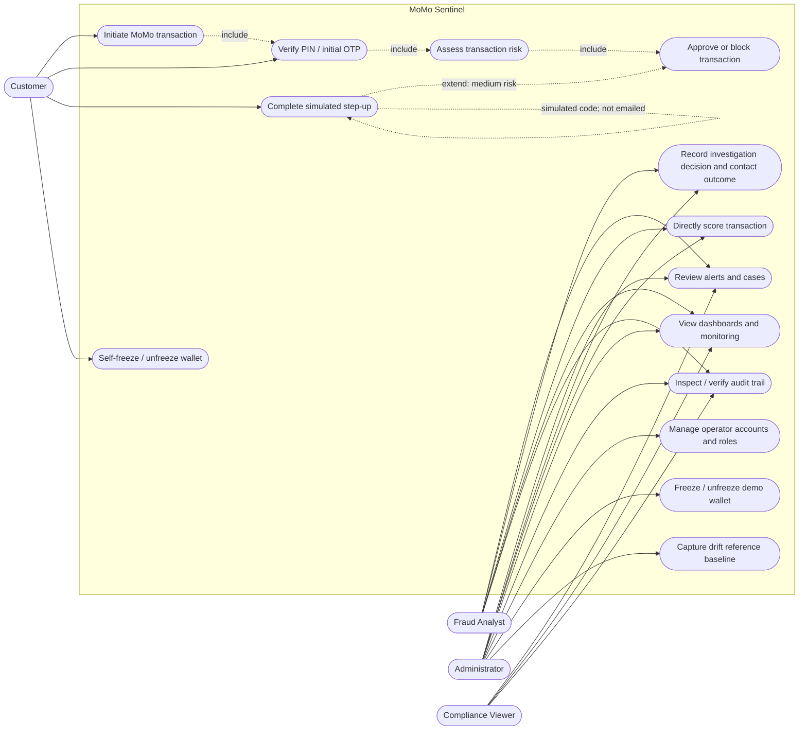
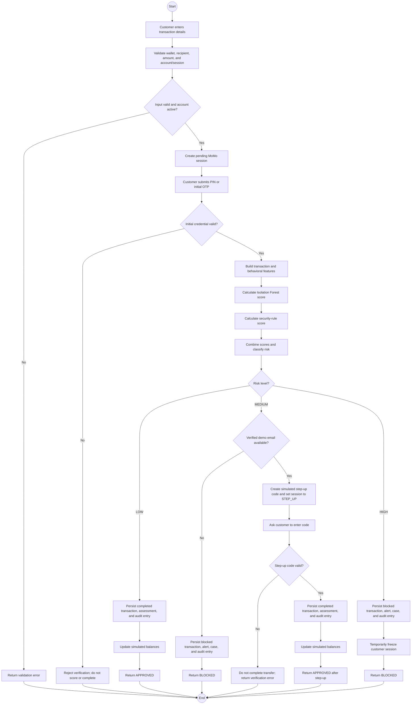
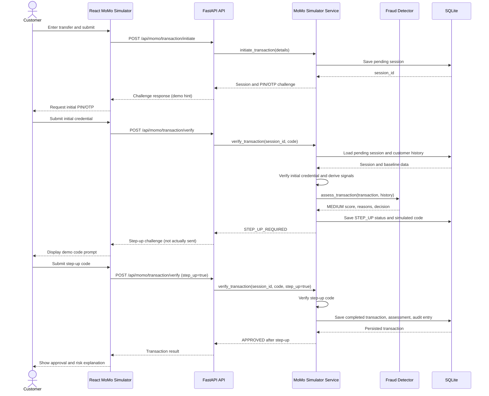
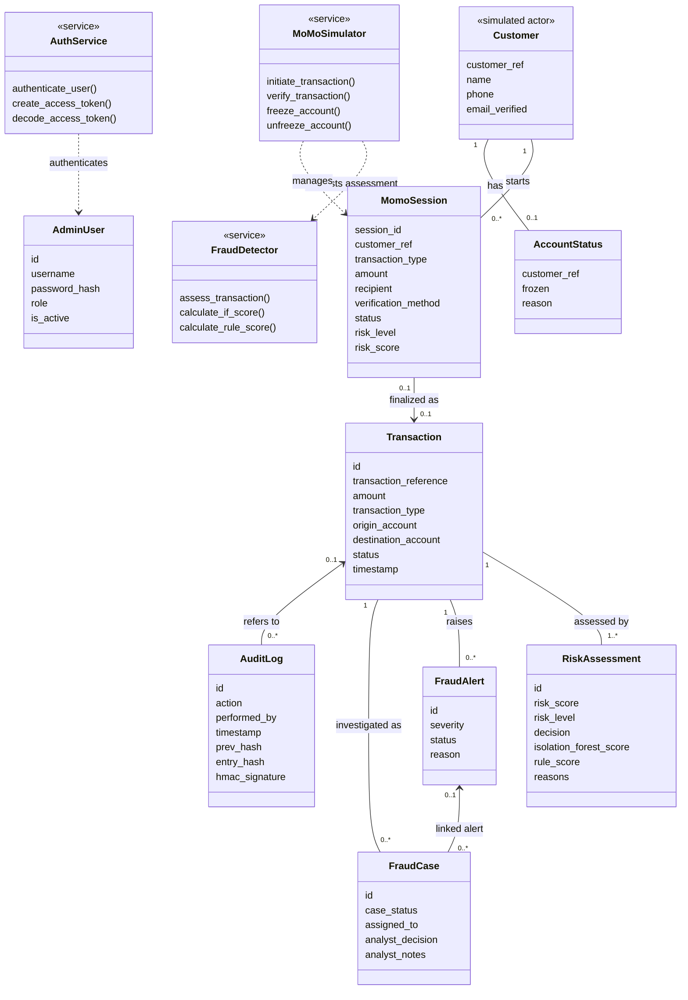
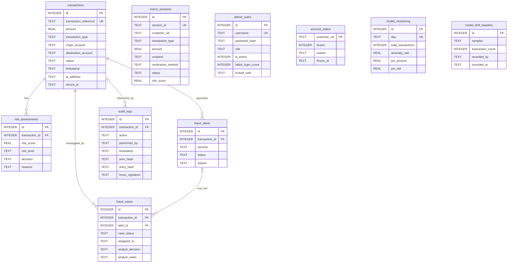
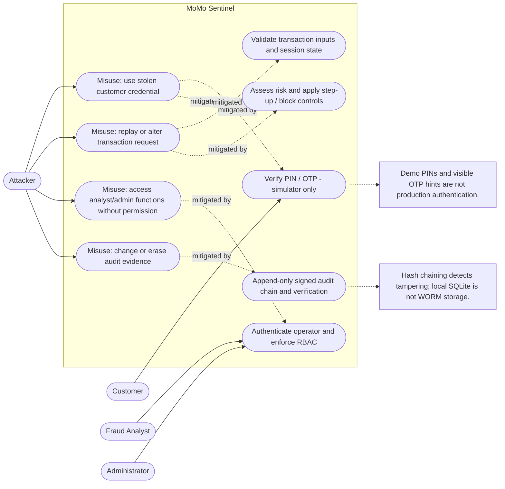

# System Analysis and Design — MoMo Sentinel

> **Project:** Ghana Mobile Money (MoMo) fraud detection and adaptive control
> prototype
> **System boundary:** React web interface, FastAPI application, fraud scoring
> services, and SQLite persistence. Wallets, bank accounts, PIN/OTP delivery,
> device/IP signals, and customer activity are simulated; this is not a live
> mobile-money integration.

This design document describes the implementation in this repository. The
diagrams use Mermaid so they render inline on GitHub and in compatible Markdown
viewers. Use-case and misuse-case views use UML-style actors, boundaries, and
relationships; the database design is an entity-relationship diagram (ERD)
alongside the UML class diagram.

## 1. System analysis

### 1.1 Problem and purpose

Mobile-money transfers can be exposed to account takeover, suspicious new
recipients, unusual transaction amounts or timing, and rapid repeated
transactions. MoMo Sentinel demonstrates a post-authentication fraud-control
layer: after a customer verifies a PIN or OTP, the system combines an
Isolation Forest anomaly score with security and behavioral rules. It approves
low-risk activity, requests simulated additional verification for medium risk,
and blocks high-risk activity while opening an investigation case.

The prototype also provides analysts with alerts and case-management tools,
administrators with account and user controls, and compliance viewers with
read-only dashboards and audit-log verification.

### 1.2 Actors

| Actor | Responsibilities |
|---|---|
| Customer | Initiates a simulated transfer, completes PIN/OTP verification, responds to a step-up check, and can freeze or unfreeze their own demo wallet using a PIN. |
| Fraud analyst | Reviews alerts and cases, records investigation decisions and simulated contact outcomes, and can submit a direct transaction for scoring. |
| Administrator | Performs analyst actions and manages user roles, demo-wallet freezes, and the model-drift reference baseline. |
| Compliance viewer | Reads dashboards, cases, alerts, monitoring, accounts, and audit records; verifies audit-chain integrity. |
| Attacker (misuse actor) | Represents an unauthorized party attempting account misuse, request manipulation, or unauthorized access to the operations console. This is a threat-model actor, not a supported system user. |

### 1.3 Key requirements

**Functional**

1. Start a wallet transfer, cash-out, or cash-in session and select the
   corresponding simulated PIN or OTP challenge.
2. Verify the customer's initial credential before scoring a transaction.
3. Build behavioral/security features and return a hybrid risk score, risk
   level, decision, and reasons.
4. Approve low-risk activity; require a simulated email step-up for medium-risk
   activity; block high-risk activity and create an alert, case, and audit
   entry.
5. Persist transaction assessments and support role-restricted investigation,
   account controls, dashboard monitoring, and audit verification.

**Security and quality**

1. Enforce role-based access for administrative functions.
2. Record consequential system/operator actions in an append-only,
   hash-chained audit log.
3. Validate transaction inputs and fail closed when required step-up
   verification is unavailable.
4. Keep the design explicit about simulated signals and credentials; no
   external telecom, bank, email, or SMS service is integrated.

### 1.4 Scope and assumptions

- This is an educational/research prototype using synthetic/demo data.
- The customer identity, wallets, balances, PINs, device/IP baselines, and
  second-factor codes are simulator data. The step-up code is displayed for
  demonstration and is not actually sent.
- Direct `/api/transactions/score` is an analyst-only assessment endpoint; it
  does not itself approve or execute a simulated transfer.
- The database uses SQLite. Entity relationships below describe the intended
  logical relationships and declared schema references.
- Fraud thresholds and model behavior are research controls, not production
  calibration or evidence of real-customer performance.

## 2. Use case diagram

## 3. Activity diagram — transaction assessment

**Note:** A failed second-factor attempt is not described as a completed
transaction; the transfer is not booked. The simulator returns a verification
error for an incorrect code.

## 4. Sequence diagram — medium-risk transfer

## 5. Class diagram — domain and service model

**Interpretation:** `Customer` and `MoMoSimulator` describe the simulator's
logical domain, not persistent customer tables. The sessions, transactions,
assessments, alerts, cases, operator accounts, account statuses, and audit
entries map to SQLite tables.

## 6. Database design (ERD)

**Database notes**

- `transactions` is the central record. Each fraud assessment refers to a
  transaction; alerts and cases also refer to the event that caused them.
- Audit records may be system-wide (no transaction) or transaction-specific.
  The database has triggers preventing ordinary updates/deletes to
  `audit_logs`; the entry hash links to the previous signed hash and an HMAC
  signature supports verification.
- `momo_sessions` represents a pending/step-up/completed/blocked simulator
  flow. Customer profiles and simulated wallet balances are held in service
  memory rather than a normalized customer table.
- `model_monitoring` and `model_drift_baseline` support dashboard monitoring;
  the baseline captures reference distributions and does not itself retrain
  the fraud model.
- The diagram shows core columns for readability; consult
  `backend/database/database.py` for the full schema and migration-added
  fields.

## 7. Misuse-case diagram — cybersecurity view

This is the UML-oriented cybersecurity diagram likely meant by the professor:
a **misuse-case diagram** shows what an attacker could try to do and which
security controls mitigate those attempts. It complements (rather than
replaces) the functional use-case diagram.

## 8. STRIDE threat summary

| STRIDE category | Example threat to this system | Existing mitigation / design response | Residual risk or limitation |
|---|---|---|---|
| Spoofing | Attacker pretends to be a customer or operator. | Simulated PIN/OTP checks; named operator accounts; signed, expiring bearer tokens. | Customer credentials and email step-up are demo-only; no real identity provider, MFA delivery, or live customer authentication. |
| Tampering | Alter a transaction request, stored assessment, or risk signal. | Input validation, session-state checks, parameterized database writes, and persisted assessment/audit records. | Browser-supplied simulator data and synthetic signals are not trusted telemetry; production APIs need deployment-grade controls and validation. |
| Repudiation | Operator denies making a case or account-control change. | Operator attribution and signed, hash-chained audit entries; audit-chain verification endpoint. | Local database administrators can still affect the underlying file or secret; remote immutable retention is not implemented. |
| Information disclosure | Unauthorized access to transaction, wallet, or investigation data. | Role-based access distinguishes admin, analyst, and viewer functions. | Deployment/network hardening, data minimization, encryption-at-rest policy, and production privacy controls are outside this prototype. |
| Denial of service | Excessive requests or long-lived event-stream connections exhaust the API. | Validation and bounded per-listener event queues exist in the implementation. | No documented production rate-limiting, distributed event service, or high-availability capacity controls. |
| Elevation of privilege | Viewer or analyst attempts admin-only actions. | Route dependencies enforce role checks; sensitive admin actions are audited. | Must protect signing secrets and deployment configuration; role tests and deployment configuration need continued review. |

## 9. Security and research limitations

- Do not use real customer details, PINs, bank credentials, or financial
  transactions with this prototype.
- Built-in accounts and simulator credentials are public demo fixtures, not
  secure defaults for a real deployment.
- Device, IP, SIM-swap, velocity, frequency, and unusual-hour signals in the
  simulator are synthetic or derived from demo data.
- The email step-up is not delivered externally; displayed codes must not be
  treated as a real second factor.
- Model metrics and thresholds are based on synthetic data and do not
  demonstrate real-world fraud-detection performance.
- A production system would require authorized representative data, real
  identity and telecom/bank integrations, secure secret management, stronger
  operational controls, independent security testing, and appropriate
  compliance review.

For implemented route and architecture details, see
[ARCHITECTURE.md](./ARCHITECTURE.md).
